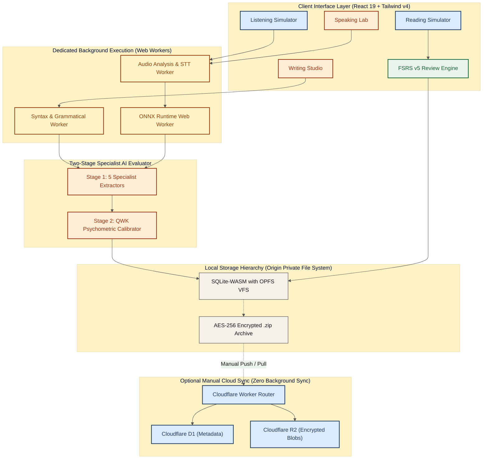
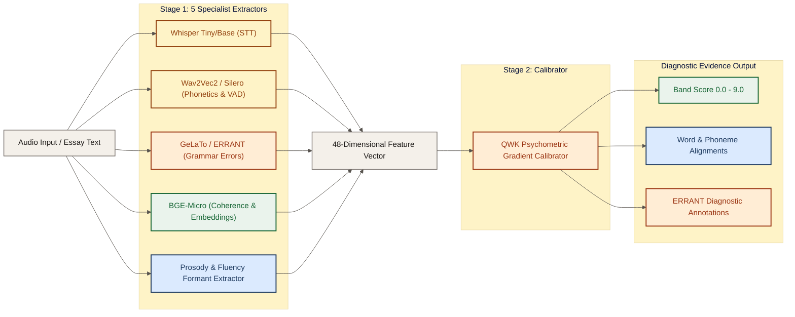
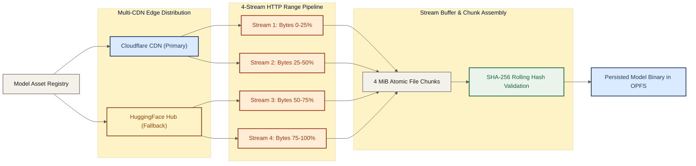
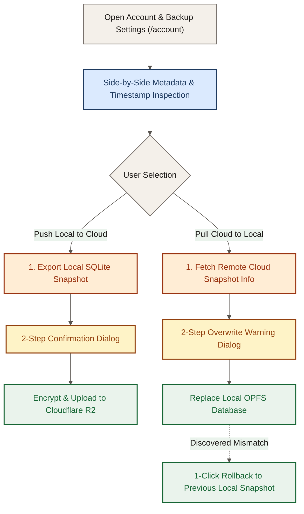

# Oxford Atelier — Local-First IELTS AI Study Studio

> **Executive Blueprint & Technical Architecture**  
> A zero-telemetry, offline-first IELTS preparation environment running entirely inside browser Web Workers and OPFS.
> 
> Made with ♥ by **Rafael Atantya**, **Claude**, **Hermes Agent**, and **Antigravity**.

[](megaplan.md)
[](DESIGN.md)
[](screen/00-index.md)

---

## 1. Local-First System Architecture

Oxford Atelier executes all four sub-test simulations and AI scoring pipelines entirely client-side. Zero audio recordings or essay drafts leave the browser without explicit manual user action.



---

## 2. Two-Stage Specialist Evaluator & Model Packs

Speaking and writing assessments use a psychometrically calibrated two-stage pipeline. Stage 1 extracts multi-dimensional acoustic, phonemic, grammatical, and coherence features. Stage 2 maps the 48-feature vector directly to official IELTS band rubrics calibrated for high Quadratic Weighted Kappa ($QWK > 0.85$).



### Model Packs & Footprint

| Pack | Model Components | Quantization | Size | Primary Function |
| :--- | :--- | :--- | :--- | :--- |
| **Tier 1 (Fast Writing & Lexical/Grammar)** | harper.js WASM + CEFR/AWL + Collocation Trie + QWK Calibrator | WASM / Pre-indexed Trie | 6.1 MB / 2 Chunks | Instant typing cadence, lexical resource, collocation checks, baseline scoring |
| **Tier 2 (Speaking Core Auto-Scoring)** | Whisper-base.en + Silero VAD v5 + Rust pYIN/nPVI DSP | ONNX INT8 / Rust WASM | 76.2 MB / 19 Chunks | Speech-to-text, acoustic pause analysis, pitch tracking, speech rate diagnostics |
| **Tier 3 (Deep Phoneme IPA GOP & Advanced GEC)** | Wav2Vec2-CTC + SpeechOcean762 GOPT + Flan-T5-GEC/DeBERTa-GED + DeBERTa Cross-Encoder | ONNX INT8 / Q4 | 116.0 MB / 29 Chunks | Phoneme-level Goodness of Pronunciation (GOP), deep grammatical error correction |
| **Optional TTS (Offline Neural Examiner Voice Pack)** | British / Australian / US Neural Voices (Piper ONNX) | ONNX INT8 | 80.0 MB / 20 Chunks | Multi-accented offline oral examiner voice simulation across all 3 speaking parts |

### Scoring & Spaced Repetition Formulas

Official IELTS overall band score calculation rounds to the nearest half-band:

$$B_O = \frac{1}{2} \cdot \left\lfloor 2 \cdot \left(\frac{B_L + B_R + B_W + B_S}{4}\right) + 0.5 \right\rfloor$$

FSRS v5 memory retention calculation:

$$R(t, S) = \left(1 + 0.19 \cdot \frac{t}{S}\right)^{-0.5}$$

FSRS v5 stability update upon successful retrieval ($G \in \lbrace 3, 4 \rbrace$):

$$S_{new} = S \cdot \left(1 + e^{w_8} \cdot (11 - D) \cdot S^{-w_9} \cdot (e^{w_{10} \cdot (1 - R)} - 1)\right)$$

---

## 3. Multi-CDN 4-Stream Range Downloader

AI models are downloaded with parallel HTTP `Range` requests, segmented into uniform 4 MiB chunks, and written directly into OPFS with crash resilience and automatic SHA-256 validation.



---

## 4. Zero-Background-Sync Manual Cloud Snapshot Flow

Data ownership remains with the candidate. There is no continuous background polling or silent syncing. All cloud snapshot interactions occur through explicit user confirmation in the Account settings.



---

## 5. Screen Map

The application follows the normative **Oxford Atelier** design system and the strict anti-hallucination UI contract specified in [`screen/00-index.md`](./screen/00-index.md):

| Screen | Route / View | Specification Document | Primary Interface & Responsibility |
| :---: | :--- | :--- | :--- |
| `00` | Global Shell | [`screen/00-index.md`](./screen/00-index.md) | Global app shell, navigation drawer, status bars, anti-hallucination UI contract |
| `01` | `/onboarding` | [`screen/01-onboarding.md`](./screen/01-onboarding.md) | Target band picker, diagnostic test triage, AI model initialization |
| `02` | `/dashboard` | [`screen/02-dashboard.md`](./screen/02-dashboard.md) | Study command center, readiness gauges, daily study queue |
| `03` | `/speaking` | [`screen/03-speaking-lobby.md`](./screen/03-speaking-lobby.md) | Speaking lab lobby, acoustic environment check, mic calibration |
| `04` | `/speaking/simulator` | [`screen/04-speaking-simulator.md`](./screen/04-speaking-simulator.md) | 3-part interactive oral exam with Piper TTS examiner & waveform |
| `05` | `/speaking/diagnostic` | [`screen/05-speaking-diagnostic.md`](./screen/05-speaking-diagnostic.md) | 5-panel speaking diagnostic: fluency, lexical, grammar, phonology |
| `06` | `/writing` | [`screen/06-writing-lab.md`](./screen/06-writing-lab.md) | Task 1 & 2 writing lab with distraction-free typography and timing |
| `07` | `/reading` | [`screen/07-reading-simulator.md`](./screen/07-reading-simulator.md) | Authentic split-pane reading test with inline question forms |
| `08` | `/listening` | [`screen/08-listening-simulator.md`](./screen/08-listening-simulator.md) | Audio track controller with unpausable realistic exam pacing |
| `09` | `/review` | [`screen/09-fsrs-review.md`](./screen/09-fsrs-review.md) | FSRS v5 vocabulary and error review deck with flip cards |
| `10` | `/features` | [`screen/10-ai-features-models.md`](./screen/10-ai-features-models.md) | AI feature catalog, model management, download orchestrator |
| `11` | `/account` | [`screen/11-account-backup-sync.md`](./screen/11-account-backup-sync.md) | OPFS storage manager, local `.zip` export, optional manual cloud sync |

---

## 6. Quick Start

Ensure you have Node.js 20+ and `pnpm` installed.

```bash
# 1. Install workspace dependencies
pnpm install

# 2. Launch local Vite development server
pnpm dev

# 3. Compile type-safe production bundle
pnpm build

# 4. Preview with local Cloudflare Pages / Wrangler runtime
pnpm pages:dev
```
