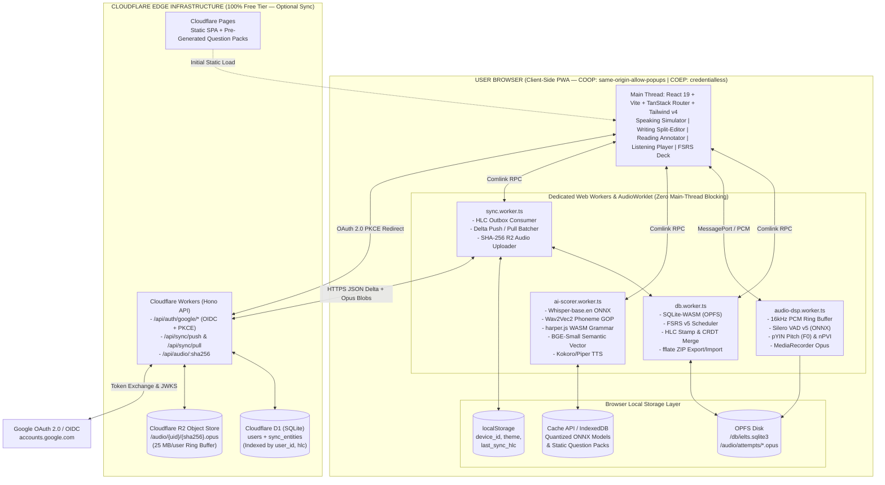
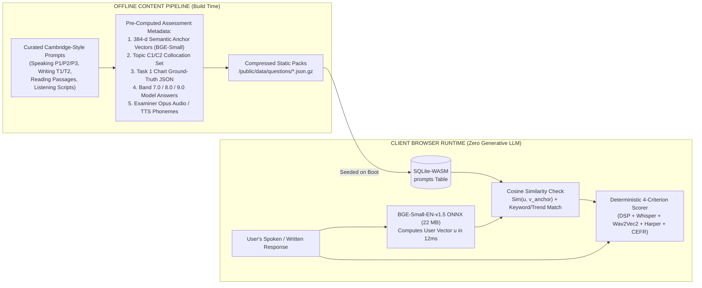
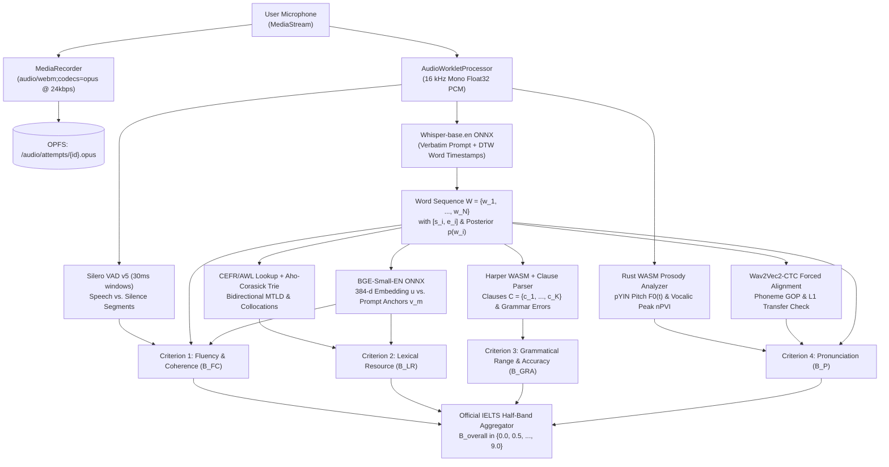
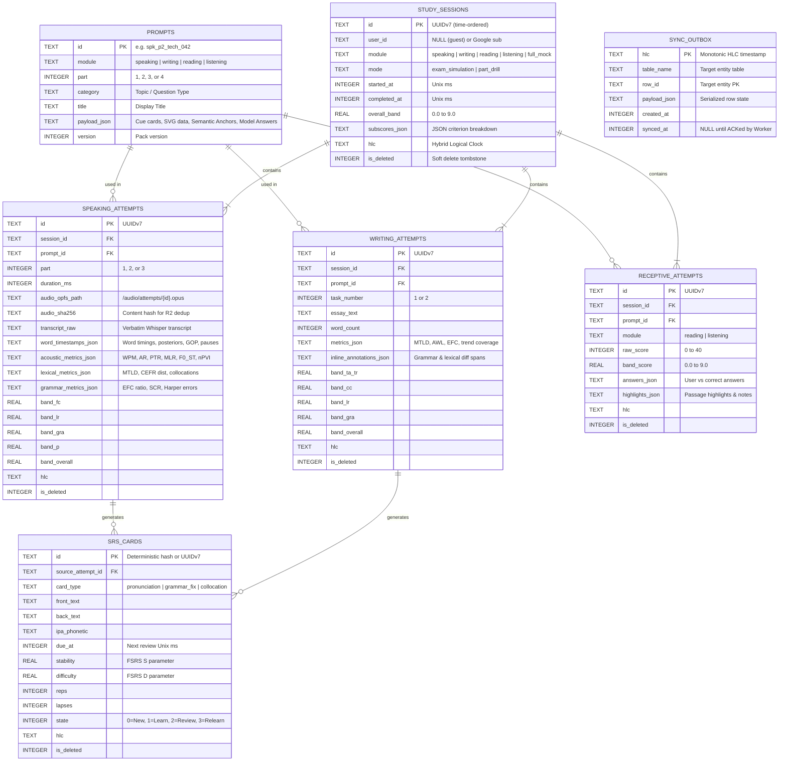
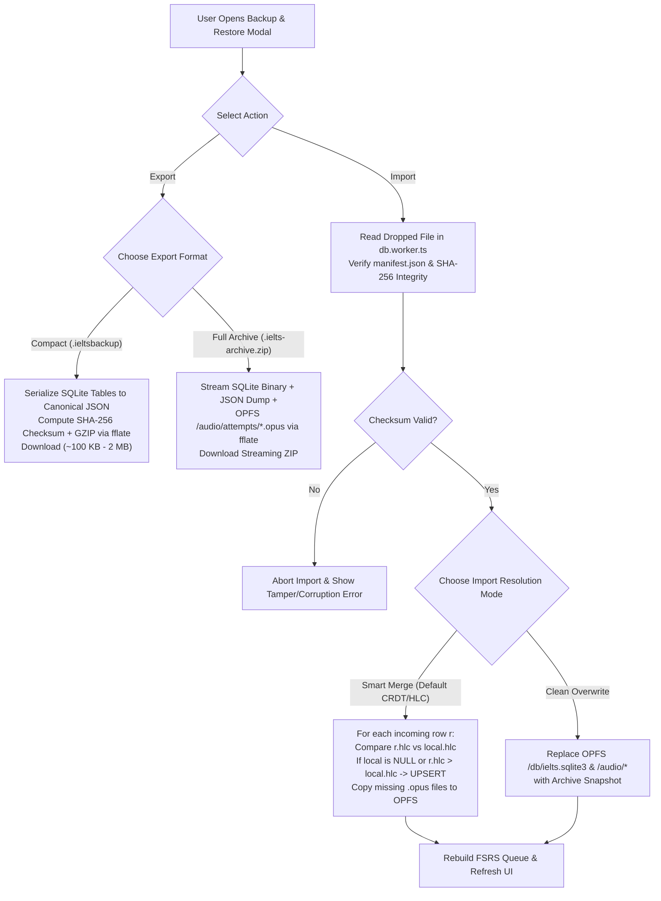
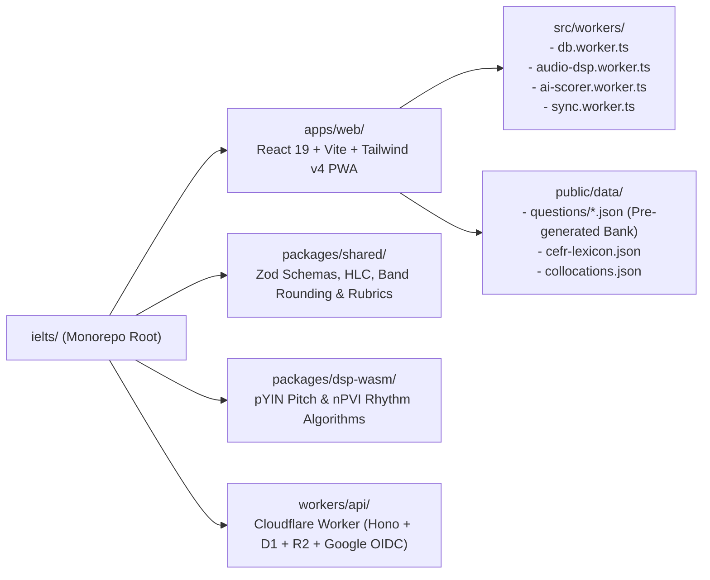

# IELTS Local-First AI Study Platform — Ultra System Design & Megaplan

> **Repository**: `rafaelatantya/ielts`  
> **Architecture Paradigm**: Local-First Web Application (PWA) + 100% Deterministic & Specialized ONNX/WASM Scoring + Pre-Generated Curated Question Bank + Optional Zero-Cost Edge Sync  
> **Hosting & Cloud Sync**: Cloudflare Pages + Cloudflare Workers + Cloudflare D1 + Cloudflare R2 (100% Free Tier, USD 0/month)  
> **Authentication**: Google OAuth 2.0 / OpenID Connect (PKCE)  
> **Offline Capability**: 100% functional without login or internet connection

---

## Table of Contents

1. [Executive Summary & Core Architectural Tenets](#1-executive-summary--core-architectural-tenets)
2. [End-to-End System Architecture (Mermaid)](#2-end-to-end-system-architecture-mermaid)
3. [Why Zero On-Device Generative LLM? The Pre-Generated Question Bank Architecture](#3-why-zero-on-device-generative-llm-the-pre-generated-question-bank-architecture)
4. [Complete Technology Stack & Specialized WASM/ONNX Models](#4-complete-technology-stack--specialized-wasmonnx-models)
5. [IELTS Speaking Auto-Scoring Engine (Mathematical & DSP Formulation)](#5-ielts-speaking-auto-scoring-engine-mathematical--dsp-formulation)
6. [Writing, Reading, Listening & FSRS v5 Study Modules](#6-writing-reading-listening--fsrs-v5-study-modules)
7. [Local-First Storage Architecture & ER Schema (Mermaid + SQL)](#7-local-first-storage-architecture--er-schema-mermaid--sql)
8. [Deterministic Export & Import System (Backup / Restore / CRDT Merge)](#8-deterministic-export--import-system-backup--restore--crdt-merge)
9. [Google OAuth 2.0 & Multi-Device HLC Sync Protocol (Mermaid)](#9-google-oauth-20--multi-device-hlc-sync-protocol-mermaid)
10. [Cloudflare Free-Tier Capacity Math & Cost Guardrails](#10-cloudflare-free-tier-capacity-math--cost-guardrails)
11. [Security, Privacy & Cross-Origin Isolation](#11-security-privacy--cross-origin-isolation)
12. [Monorepo Structure & Phased Implementation Roadmap](#12-monorepo-structure--phased-implementation-roadmap)

---

## 1. Executive Summary & Core Architectural Tenets

### 1.1 Core Tenets

1. **Local-First by Default (Zero Server Dependency)**
   - Users can open the web app, never create an account, disconnect from Wi-Fi, complete full Speaking, Writing, Reading, and Listening tests, receive instant Band $0.0\text{--}9.0$ diagnostic breakdowns, and review spaced-repetition flashcards.
   - All user state is persisted in **SQLite-WASM** backed by the browser's **Origin Private File System (OPFS)** via `FileSystemSyncAccessHandle`.
2. **Pre-Generated Curated Question Bank (Zero On-Device Generative LLM)**
   - Small on-device generative LLMs ($1\text{B--}3\text{B}$ parameters such as Qwen-1.5B or Llama-1B) produce low-quality, unnatural IELTS questions, hallucinate grammar explanations, and require $800\text{ MB--}1.5\text{ GB}$ of VRAM.
   - Instead, **all questions, cue cards, Part 3 follow-up trees, reading passages, listening scripts, and Band 7.0/8.0/9.0 model answers are pre-generated and curated offline** in a structured Question Bank (`prompts`).
   - Each question in the bank ships with **pre-computed semantic anchor embeddings**, **topic-specific C1/C2 collocation targets**, and **ground-truth rubric checklists**.
3. **100% Client-Side Acoustic, Phonetic & NLP Auto-Scoring (WASM + ONNX)**
   - Rather than a bloated generative LLM, the browser runs **small, surgical, specialized WASM/ONNX encoders** ($\approx 135\text{ MB}$ total cached once):
     - **Silero VAD v5 (`1.8 MB`)**: Frame-exact speech vs. pause segmentation ($30\text{ ms}$ frames).
     - **Rust/WASM DSP (`< 500 KB`)**: Fundamental frequency ($F_0$) pitch contour in semitones and stress-timed rhythm ($\text{nPVI}$).
     - **Whisper ONNX (`whisper-base.en`, `~74 MB`)**: Verbatim speech-to-text with disfluency preservation, word-level timestamps, and acoustic confidence posteriors.
     - **Wav2Vec2-CTC Phoneme Aligner (`~32 MB`)**: Phoneme-level Goodness of Pronunciation ($\text{GOP}$) and Indonesian L1 phonological interference detection.
     - **Harper WASM (`harper.js`, `~3.2 MB`) + Clause Parser**: Deterministic sub-$50\text{ ms}$ grammatical error detection and syntactic complexity analysis.
     - **BGE-Small Embedding Encoder (`bge-small-en-v1.5` int8 ONNX, `~22 MB`)**: Computes cosine similarity between the user's response and the question's pre-computed semantic anchors in $< 15\text{ ms}$ to verify topic relevance and detect memorized off-topic scripts.
4. **Sovereign Data Ownership (Export & Import)**
   - Users can export their entire progress at any time as a compact `.ieltsbackup` (`JSON.gz`) or a full `.ielts-archive.zip` (containing the SQLite database and `.opus` voice recordings) and import it on any device with **CRDT/HLC Smart Merge**.
5. **Optional Google Login & Multi-Device Sync on Cloudflare Free Tier (USD 0/month)**
   - Logging in with Google activates background **Hybrid Logical Clock (HLC) Delta Sync** to **Cloudflare D1** (relational rows) and **Cloudflare R2** (content-addressed `.opus` recordings).

---

## 2. End-to-End System Architecture (Mermaid)



---

## 3. Why Zero On-Device Generative LLM? The Pre-Generated Question Bank Architecture

Using an on-device generative LLM (such as Qwen-1.5B or Llama-1B) to generate IELTS questions or grade open-ended answers on the fly is an **anti-pattern** because:
1. **Low Prompt Quality**: Small LLMs drift from official Cambridge IELTS phrasing, invent invalid Reading `True/False/Not Given` logic, and ask repetitive Part 3 questions.
2. **Grading Hallucinations**: Small LLMs hallucinate grammar rules and produce non-deterministic band scores across runs.
3. **Massive Resource Bloat**: Downloading $800\text{ MB+}$ of weights and allocating $1.5\text{ GB}$ of WebGPU VRAM crashes mobile browsers and low-RAM laptops.

### 3.1 The Pre-Generated Static Question Bank + Semantic Anchor Solution

Because our question bank is **pre-generated and curated offline**, every prompt already carries its exact assessment targets before it reaches the user's browser:



### 3.2 What Each Pre-Generated Prompt Pack Contains

```json
{
  "id": "spk_p2_tech_042",
  "module": "speaking",
  "part": 2,
  "topic": "Technology & Daily Life",
  "cue_card": {
    "prompt": "Describe a piece of technology (not a phone) that you find particularly useful.",
    "bullets": [
      "What the technology is and when you got it",
      "How often and for what purpose you use it",
      "How it compares to older ways of doing the same task",
      "And explain why you find it so useful in your daily life"
    ]
  },
  "part3_followup_tree": [
    {
      "id": "spk_p3_tech_042_q1",
      "question": "Why do some older people find it challenging to adopt new household technologies?",
      "semantic_anchors_b64": "...",
      "target_collocations": [
        "steep learning curve",
        "digital literacy",
        "user-friendly interface",
        "technological obsolescence"
      ],
      "model_answer_band85": "Primarily, I'd say it comes down to a steep learning curve combined with interfaces that aren't always designed with accessibility in mind..."
    }
  ],
  "semantic_anchors_b64": "<Base64 Float32Array of 4 x 384-dim BGE-small vectors for the 4 cue-card bullets>",
  "target_collocations": [
    "time-saving device",
    "boost productivity",
    "seamlessly integrate",
    "indispensable tool"
  ]
}
```

---

## 4. Complete Technology Stack & Specialized WASM/ONNX Models

| Component | Technology / Model | Size (Quantized) | Execution Target | Exact Role |
| :--- | :--- | :--- | :--- | :--- |
| **Frontend UI** | React 19 + Vite + TanStack Router + Tailwind v4 | `~180 KB` | Main Thread | Exam interfaces, waveform canvas, diagnostic UI |
| **Local Database** | `@sqlite.org/sqlite-wasm` (OPFS VFS) | `~850 KB` | `db.worker.ts` | ACID relational storage, FTS5 search, outbox log |
| **Voice Activity Detection** | **Silero VAD v5** (`silero_vad.onnx`) | **`1.8 MB`** | `audio-dsp.worker.ts` | $30\text{ ms}$ frame speech/silence probabilities |
| **Acoustic Prosody DSP** | **Rust $\to$ WASM DSP** (`pitch-detection` + `fft`) | **`0.4 MB`** | `audio-dsp.worker.ts` | Pitch contour $F_0(t)$ in semitones & rhythm $\text{nPVI}$ |
| **Speech-to-Text (ASR)** | **Whisper ONNX** (`whisper-base.en` q8 / WebGPU fp16) | **`74 MB`** | `ai-scorer.worker.ts` | Verbatim transcript, word timestamps, token logprobs |
| **Phoneme Pronunciation** | **Wav2Vec2-CTC** (`wav2vec2-lv-60-espeak-cv-ft` q8) | **`32 MB`** | `ai-scorer.worker.ts` | IPA forced alignment & Goodness of Pronunciation ($\text{GOP}$) |
| **Semantic Relevance** | **BGE-Small-EN v1.5** (`bge-small-en-v1.5` q8 ONNX) | **`22 MB`** | `ai-scorer.worker.ts` | $384\text{-d}$ cosine similarity vs. prompt semantic anchors |
| **Grammar & Syntax Engine** | **Harper WASM** (`harper.js`) + Clause Dependency | **`3.2 MB`** | `ai-scorer.worker.ts` | Sub-$50\text{ ms}$ grammar check + Error-Free Clause ratio |
| **Lexical Profiler** | **SQLite CEFR/AWL Table + Aho-Corasick Trie** | **`2.5 MB`** | `ai-scorer.worker.ts` | $15,000$ CEFR headwords + $6,500$ IELTS collocations |
| **Examiner Voice (TTS)** | **Kokoro-82M ONNX** or Pre-Packaged Opus Audio | **`80 MB`** (optional) | `ai-scorer.worker.ts` | Offline British/Australian/US voice for examiner |
| **Spaced Repetition** | **FSRS v5** (`ts-fsrs`) | `~15 KB` | `db.worker.ts` | Optimal memory scheduling for error flashcards |
| **Backup Archive** | **fflate** (Streaming ZIP/GZIP) | `~12 KB` | `db.worker.ts` | Zero-RAM-spike `.ieltsbackup` & `.ielts-archive.zip` |

> **Total Core Scoring Footprint**: **$\approx 135\text{ MB}$** cached once in the browser's `Cache API` / `IndexedDB` — **nearly $7\times$ smaller and $10\times$ faster** than running a generative LLM, while working on standard laptops and phones without requiring a dedicated GPU.

---

## 5. IELTS Speaking Auto-Scoring Engine (Mathematical & DSP Formulation)

### 5.1 End-to-End Speaking Signal Flow (Mermaid)



### 5.2 Preserving Verbatim Disfluencies in Whisper

Standard Whisper strips out `"um"`, `"uh"`, and false starts, which would artificially inflate a candidate's Fluency score. We condition Whisper's decoder with a **verbatim disfluency prefix prompt**:

```ts
const VERBATIM_INITIAL_PROMPT =
  "Um, uh, er, ah, hmm, like, you know, I mean, well, so, actually... " +
  "I- I think, the the thing is, let me see.";
```

With `return_timestamps: "word"`, Whisper outputs a sequence of $N$ words $W = \{w_1, w_2, \dots, w_N\}$, where each word $w_i$ has start time $s_i$, end time $e_i$, and acoustic token probability $p(w_i) \in (0, 1]$.

---

### 5.3 Criterion 1: Fluency and Coherence ($B_{\text{FC}}$)

Let $T_{\text{total}}$ be total response duration in seconds, and let $T_{\text{speech}}$ be total phonation time where Silero VAD probability $p_{\text{VAD}}(t) > 0.5$.

#### 1. Speech Rate ($\text{WPM}$) and Articulation Rate ($\text{AR}$)

$$
\text{WPM} = \frac{60 \cdot N}{T_{\text{total}}}, \qquad \text{AR} = \frac{\sum_{i=1}^{N} \text{syllables}(w_i)}{T_{\text{speech}}}
$$

#### 2. Phonation-Time Ratio ($\text{PTR}$)

$$
\text{PTR} = \frac{T_{\text{speech}}}{T_{\text{total}}} \in [0, 1]
$$

#### 3. Structural Clause-Boundary Pauses vs. Mid-Clause Hesitation Pauses
For every inter-word gap $\Delta t_i = s_{i+1} - e_i$:
- **Micro-pause** ($\Delta t_i < 0.25\text{ s}$): Natural articulatory stop closure (ignored).
- **Clause-Boundary Pause** ($\Delta t_i \in [0.25\text{ s}, 0.80\text{ s}]$ at punctuation `.`, `,`, `;` or conjunction boundary): Natural breathing/prosodic boundary (**zero penalty**).
- **Mid-Clause Hesitation Pause ($P_{\text{mid}}$)**: $\Delta t_i \ge 0.40\text{ s}$ occurring **inside** a syntactic phrase (e.g., between determiner and noun `"the [0.6s] government"`). Counted per $100$ words:

$$
R_{P_{\text{mid}}} = \frac{100}{N} \cdot \left| \left\{ i : \Delta t_i \ge 0.40 \land \neg\text{isClauseBoundary}(i) \right\} \right|
$$

- **Long Freeze Pause Rate ($R_{P_{\text{long}}}$)**: Pauses where $\Delta t_i \ge 1.20\text{ s}$ per $100$ words:

$$
R_{P_{\text{long}}} = \frac{100}{N} \cdot \left| \left\{ i : \Delta t_i \ge 1.20 \right\} \right|
$$

#### 4. Mean Length of Run ($\text{MLR}$)
Average number of words spoken continuously between any pauses $\Delta t_i \ge 0.30\text{ s}$:

$$
\text{MLR} = \frac{N}{1 + \left| \left\{ i : \Delta t_i \ge 0.30 \right\} \right|}
$$

#### 5. Disfluency Rate ($\text{DFR}$)

$$
\text{DFR} = \frac{100}{N} \left( N_{\text{fillers}} + N_{\text{repeats}} + N_{\text{false\_starts}} \right)
$$

#### 6. Semantic Topic Relevance Gate ($\tau_{\text{topic}}$)
Let $\mathbf{u} \in \mathbb{R}^{384}$ be the `bge-small-en-v1.5` embedding of the candidate's transcript and $\{\mathbf{v}_1, \dots, \mathbf{v}_M\}$ be the pre-computed semantic anchor vectors for the prompt:

$$
\tau_{\text{topic}} = \max_{m \in \{1,\dots,M\}} \frac{\mathbf{u} \cdot \mathbf{v}_m}{\|\mathbf{u}\|_2 \, \|\mathbf{v}_m\|_2}
$$

If $\tau_{\text{topic}} < 0.45$, an off-topic penalty $\Delta_{\text{topic}} = -1.5$ is applied (preventing candidates from reciting a memorized speech unrelated to the question).

#### 7. Combined Fluency & Coherence Score ($\hat{B}_{\text{FC}}$)

$$
\hat{B}_{\text{FC}} = \text{clamp}_{[1, 9]}\left( 9.0 - \frac{\alpha_1 \max(0, 130 - \text{WPM}) + \alpha_2 R_{P_{\text{mid}}} + \alpha_3 R_{P_{\text{long}}} + \alpha_4 \text{DFR} + \alpha_5 \max(0, 8.0 - \text{MLR})}{1 + 0.15 S_{\text{cohesion}}} + \Delta_{\text{topic}} \right)
$$

---

### 5.4 Criterion 2: Lexical Resource ($B_{\text{LR}}$)

#### 1. Bidirectional MTLD (Measure of Textual Lexical Diversity)
Unlike raw Type-Token Ratio ($\text{TTR} = \frac{V}{N}$), which unfairly penalizes longer Part 2 speeches, $\text{MTLD}$ counts the average number of words required for running $\text{TTR}$ to drop to threshold $\theta = 0.72$ in both forward and backward passes:

$$
\text{MTLD} = \frac{\text{MTLD}_{\text{forward}}(\theta) + \text{MTLD}_{\text{backward}}(\theta)}{2}
$$

#### 2. CEFR & Academic Word List Sophistication Index ($S_{\text{CEFR}}$)
For all lemmatized content words $N_{\text{content}}$ matched against the local `cefr_lexicon` table:

$$
S_{\text{CEFR}} = \frac{1.0 N_{\text{B1}} + 2.0 N_{\text{B2}} + 3.5 N_{\text{C1}} + 5.0 N_{\text{C2}}}{N_{\text{content}}}, \qquad R_{\text{adv}} = \frac{N_{\text{B2}} + N_{\text{C1}} + N_{\text{C2}} + N_{\text{AWL}}}{N_{\text{content}}}
$$

#### 3. Idiomatic & Collocation Density ($S_{\text{colloc}}$)
Let $N_{\text{colloc}}$ be the number of distinct multi-word collocations and phrasal verbs matched by the Aho-Corasick automaton (including prompt-specific `target_collocations`), and $N_{\text{cliche}}$ be memorized template cliches:

$$
S_{\text{colloc}} = \min\left( 1.0, \; \frac{N_{\text{colloc}} + 0.2 N_{\text{cliche}}}{4.0} \right)
$$

#### 4. Prompt Paraphrasing Score ($S_{\text{para}}$)
Given prompt content lemmas $L_Q$ and the candidate's opening response lemmas $L_A$:

$$
S_{\text{para}} = \tau_{\text{topic}} \cdot \left( 1 - \frac{|L_Q \cap L_A|}{|L_Q \cup L_A|} \right)
$$

High semantic similarity ($\tau_{\text{topic}}$) paired with low verbatim word copying yields a high paraphrasing score.

---

### 5.5 Criterion 3: Grammatical Range and Accuracy ($B_{\text{GRA}}$)

#### 1. Error-Free Clause Ratio ($\text{EFC}$)
The transcript is split into $K$ clauses $C = \{c_1, c_2, \dots, c_K\}$. Using `harper.js` (WASM) and morphosyntactic agreement rules (subject-verb agreement, tense consistency, article usage, preposition subcategorization):

$$
\text{EFC} = \frac{\left| \left\{ c_k \in C : \text{errorCount}(c_k) = 0 \right\} \right|}{K}
$$

#### 2. Weighted Error Density ($\text{WED}$)
Errors are classified by severity weight $\omega_e \in \{0.5\text{ (minor slip)}, 1.0\text{ (local error)}, 2.0\text{ (communication-impeding)}\}$:

$$
\text{WED} = \frac{\sum_{e \in E} \omega_e}{K}
$$

#### 3. Syntactic Complexity & Range Index ($S_{\text{range}}$)
Let $K_{\text{sub}}$ be the number of subordinate/dependent clauses and $F_{\text{used}} \in \{0, \dots, 10\}$ be the count of distinct complex grammatical families detected (relative clauses, conditionals, passive voice, perfect continuous, modals of deduction, cleft sentences, participial phrases, comparatives, subjunctive, negative inversion):

$$
\text{SCR} = \frac{K_{\text{sub}}}{K}, \qquad S_{\text{range}} = 0.6 \cdot \min\left(1.0, \frac{F_{\text{used}}}{5.0}\right) + 0.4 \cdot \min\left(1.0, \frac{\text{SCR}}{0.40}\right)
$$

#### 4. Combined GRA Score ($\hat{B}_{\text{GRA}}$)

$$
\hat{B}_{\text{GRA}} = \text{clamp}_{[1, 9]}\left( 3.0 + 4.2 \cdot \text{EFC} + 2.2 \cdot S_{\text{range}} - 1.5 \cdot \text{WED} \right)
$$

---

### 5.6 Criterion 4: Pronunciation ($B_{\text{P}}$)

#### 1. ASR Acoustic Confidence & Low-Confidence Word Ratio ($\text{LCWR}$)

$$
\bar{P}_{\text{ASR}} = \frac{1}{N} \sum_{i=1}^{N} p(w_i), \qquad \text{LCWR} = \frac{\left| \left\{ w_i : p(w_i) < 0.65 \right\} \right|}{N}
$$

#### 2. Phoneme Goodness of Pronunciation ($\text{GOP}$) & Indonesian L1 Transfer
For each target phoneme $\phi$ spanning audio frames $t \in [t_1, t_2]$ with duration $T_\phi = t_2 - t_1 + 1$, Wav2Vec2-CTC yields frame posterior $P(\phi \mid x_t)$:

$$
\text{GOP}(\phi) = \frac{1}{T_\phi} \sum_{t=t_1}^{t_2} \log \left( \frac{P(\phi \mid x_t)}{\max_{\psi \in \Phi} P(\psi \mid x_t)} \right) \le 0
$$

The analyzer specifically flags common Indonesian L1 phonological substitutions:
- Dental fricatives: $/ \theta / \to / \text{t} /$ (*think* $\to$ *tink*) and $/ \eth / \to / \text{d} /$ (*that* $\to$ *dat*)
- Labiodental fricative: $/ \text{v} / \to / \text{f} /$ (*very* $\to$ *fery*)
- Palato-alveolar sibilant: $/ \int / \to / \text{s} /$ (*she* $\to$ *see*)
- Final cluster reduction & missing inflectional codas (`-ed` $/ \text{t}, \text{d}, \text{Id} /$ and `-s` $/ \text{s}, \text{z}, \text{Iz} /$)

#### 3. Gender-Invariant Pitch Variation in Semitones ($\sigma_{F_0,\text{ST}}$)
Using the pYIN pitch detector over voiced frames, raw frequency $F_0(t)$ (Hz) is normalized against the speaker's median frequency $F_{0,\text{med}}$:

$$
f_{\text{ST}}(t) = 12 \log_2 \left( \frac{F_0(t)}{F_{0,\text{med}}} \right), \qquad \sigma_{F_0,\text{ST}} = \sqrt{\frac{1}{T_{\text{voiced}}} \sum_{t=1}^{T_{\text{voiced}}} \left( f_{\text{ST}}(t) - \bar{f}_{\text{ST}} \right)^2}
$$

- Flat/monotone delivery: $\sigma_{F_0,\text{ST}} < 1.8\text{ ST}$ (penalized).
- Natural expressive English prosody: $2.5 \le \sigma_{F_0,\text{ST}} \le 4.8\text{ ST}$.

#### 4. Stress-Timed Rhythm via Normalized Pairwise Variability Index ($\text{nPVI}$)
Given $m$ consecutive vocalic syllable nucleus durations $\{d_1, d_2, \dots, d_m\}$:

$$
\text{nPVI} = \frac{100}{m - 1} \sum_{k=1}^{m-1} \left| \frac{d_k - d_{k+1}}{\frac{d_k + d_{k+1}}{2}} \right|
$$

- Syllable-timed rhythm (flat syllable lengths): $\text{nPVI} < 42$.
- Native stress-timed English target: $52 \le \text{nPVI} \le 68$.

---

### 5.7 Official IELTS Half-Band Rounding Formula

Each criterion score $B_c$ ($c \in \{\text{FC}, \text{LR}, \text{GRA}, \text{P}\}$) and the overall Speaking band $B_{\text{Speaking}}$ are rounded to the nearest $0.5$ band using the official IELTS rounding rule:

$$
B_c = \frac{\lfloor 2 \hat{B}_c + 0.5 \rfloor}{2}, \qquad \bar{B} = \frac{B_{\text{FC}} + B_{\text{LR}} + B_{\text{GRA}} + B_{\text{P}}}{4}, \qquad B_{\text{Speaking}} = \frac{\lfloor 2 \bar{B} + 0.5 \rfloor}{2}
$$

---

## 6. Writing, Reading, Listening & FSRS v5 Study Modules

### 6.1 IELTS Writing Auto-Scoring Lab (Task 1 & Task 2)
- **Pre-Generated Visuals & Ground-Truth Metadata**:
  - **Academic Task 1**: Dynamic SVG bar/line/pie charts, tables, process diagrams, and maps. Each prompt in `prompts` includes a structured ground-truth spec (`key_trends`, `max_min_entities`, `comparison_pairs`, `required_units`). The scorer deterministically checks whether the candidate's essay mentions the required overview trends and numerical comparisons.
  - **Task 2 Essay**: Curated prompts across all 5 official essay types with pre-computed semantic anchor vectors for each prompt question part.
- **Weighted Overall Writing Band**:

$$
\bar{B}_{\text{Writing}} = \frac{B_{\text{Task1}} + 2 \cdot B_{\text{Task2}}}{3}, \qquad B_{\text{Writing}} = \frac{\lfloor 2 \bar{B}_{\text{Writing}} + 0.5 \rfloor}{2}
$$

### 6.2 Reading & Listening Simulators
- **Reading**: 3-passage split-screen interface with persistent highlighters (Yellow/Pink/Cyan), margin notes, all 14 official question types, and 1-click **Evidence Span Jump** on post-test review.
- **Listening**: 4-section Opus audio player (`24 kbps`, $\approx 4.5\text{ MB}$ per full 30-minute test) + deterministic **Answer Normalizer** handling UK/US spelling (`colour`/`color`), number/word equivalence (`14`/`fourteen`), date formats, and optional bracketed tokens.

### 6.3 FSRS v5 Automated Spaced Repetition (`ts-fsrs`)
After every Speaking or Writing test, the platform automatically generates flashcards from the user's actual mistakes (mispronounced words with IPA + audio comparison, grammar error cloze cards, and C1 collocation upgrades).
For a card with stability $S$ (days) and elapsed time $t$ (days), FSRS v5 models retrievability $R(t, S)$ as:

$$
R(t, S) = \left( 1 + \frac{19}{81} \cdot \frac{t}{S} \right)^{-0.5}
$$

---

## 7. Local-First Storage Architecture & ER Schema (Mermaid + SQL)

### 7.1 Local SQLite-WASM Entity-Relationship Diagram (Mermaid)



### 7.2 Complete SQLite-WASM Database Schema (`schema.sql`)

```sql
PRAGMA journal_mode = WAL;
PRAGMA synchronous = NORMAL;
PRAGMA foreign_keys = ON;

CREATE TABLE IF NOT EXISTS local_meta (
    key TEXT PRIMARY KEY,
    value TEXT NOT NULL,
    updated_at INTEGER NOT NULL
);

CREATE TABLE IF NOT EXISTS prompts (
    id TEXT PRIMARY KEY,
    module TEXT NOT NULL,
    part INTEGER NOT NULL,
    category TEXT NOT NULL,
    title TEXT NOT NULL,
    payload_json TEXT NOT NULL,
    difficulty_band REAL DEFAULT 7.0,
    version INTEGER NOT NULL DEFAULT 1
);

CREATE TABLE IF NOT EXISTS study_sessions (
    id TEXT PRIMARY KEY,
    user_id TEXT,
    module TEXT NOT NULL,
    mode TEXT NOT NULL,
    started_at INTEGER NOT NULL,
    completed_at INTEGER,
    overall_band REAL,
    subscores_json TEXT,
    hlc TEXT NOT NULL,
    is_deleted INTEGER NOT NULL DEFAULT 0
);

CREATE INDEX IF NOT EXISTS idx_sessions_module_date ON study_sessions(module, started_at DESC);
CREATE INDEX IF NOT EXISTS idx_sessions_hlc ON study_sessions(hlc);

CREATE TABLE IF NOT EXISTS speaking_attempts (
    id TEXT PRIMARY KEY,
    session_id TEXT NOT NULL REFERENCES study_sessions(id) ON DELETE CASCADE,
    prompt_id TEXT NOT NULL,
    part INTEGER NOT NULL,
    question_text TEXT NOT NULL,
    duration_ms INTEGER NOT NULL,
    audio_opfs_path TEXT,
    audio_sha256 TEXT,
    audio_size_bytes INTEGER,
    audio_r2_synced INTEGER NOT NULL DEFAULT 0,
    transcript_raw TEXT NOT NULL,
    word_timestamps_json TEXT NOT NULL,
    acoustic_metrics_json TEXT NOT NULL,
    lexical_metrics_json TEXT NOT NULL,
    grammar_metrics_json TEXT NOT NULL,
    semantic_metrics_json TEXT NOT NULL,
    band_fc REAL NOT NULL,
    band_lr REAL NOT NULL,
    band_gra REAL NOT NULL,
    band_p REAL NOT NULL,
    band_overall REAL NOT NULL,
    created_at INTEGER NOT NULL,
    hlc TEXT NOT NULL,
    is_deleted INTEGER NOT NULL DEFAULT 0
);

CREATE INDEX IF NOT EXISTS idx_speaking_session ON speaking_attempts(session_id);
CREATE INDEX IF NOT EXISTS idx_speaking_hlc ON speaking_attempts(hlc);

CREATE TABLE IF NOT EXISTS writing_attempts (
    id TEXT PRIMARY KEY,
    session_id TEXT NOT NULL REFERENCES study_sessions(id) ON DELETE CASCADE,
    prompt_id TEXT NOT NULL,
    task_number INTEGER NOT NULL,
    essay_text TEXT NOT NULL,
    word_count INTEGER NOT NULL,
    time_spent_ms INTEGER NOT NULL,
    metrics_json TEXT NOT NULL,
    inline_annotations_json TEXT NOT NULL,
    band_ta_tr REAL NOT NULL,
    band_cc REAL NOT NULL,
    band_lr REAL NOT NULL,
    band_gra REAL NOT NULL,
    band_overall REAL NOT NULL,
    created_at INTEGER NOT NULL,
    hlc TEXT NOT NULL,
    is_deleted INTEGER NOT NULL DEFAULT 0
);

CREATE TABLE IF NOT EXISTS receptive_attempts (
    id TEXT PRIMARY KEY,
    session_id TEXT NOT NULL REFERENCES study_sessions(id) ON DELETE CASCADE,
    prompt_id TEXT NOT NULL,
    module TEXT NOT NULL,
    raw_score INTEGER NOT NULL,
    total_questions INTEGER NOT NULL DEFAULT 40,
    band_score REAL NOT NULL,
    answers_json TEXT NOT NULL,
    highlights_json TEXT,
    created_at INTEGER NOT NULL,
    hlc TEXT NOT NULL,
    is_deleted INTEGER NOT NULL DEFAULT 0
);

CREATE TABLE IF NOT EXISTS srs_cards (
    id TEXT PRIMARY KEY,
    source_attempt_id TEXT,
    card_type TEXT NOT NULL,
    front_text TEXT NOT NULL,
    back_text TEXT NOT NULL,
    context_sentence TEXT,
    ipa_phonetic TEXT,
    due_at INTEGER NOT NULL,
    stability REAL NOT NULL DEFAULT 0,
    difficulty REAL NOT NULL DEFAULT 0,
    elapsed_days INTEGER NOT NULL DEFAULT 0,
    scheduled_days INTEGER NOT NULL DEFAULT 0,
    reps INTEGER NOT NULL DEFAULT 0,
    lapses INTEGER NOT NULL DEFAULT 0,
    state INTEGER NOT NULL DEFAULT 0,
    last_review_at INTEGER,
    hlc TEXT NOT NULL,
    is_deleted INTEGER NOT NULL DEFAULT 0
);

CREATE INDEX IF NOT EXISTS idx_srs_due ON srs_cards(is_deleted, due_at ASC);

CREATE TABLE IF NOT EXISTS sync_outbox (
    hlc TEXT PRIMARY KEY,
    table_name TEXT NOT NULL,
    row_id TEXT NOT NULL,
    payload_json TEXT NOT NULL,
    created_at INTEGER NOT NULL,
    synced_at INTEGER
);

CREATE INDEX IF NOT EXISTS idx_outbox_unsynced ON sync_outbox(synced_at) WHERE synced_at IS NULL;
```

---

## 8. Deterministic Export & Import System (Backup / Restore / CRDT Merge)

### 8.1 Export & Import State Machine (Mermaid)



### 8.2 Mathematical Guarantee of CRDT / HLC Smart Merge
Let $S_{\text{local}}$ and $S_{\text{import}}$ be two database states (e.g., from a user's laptop and phone). Every mutable row $x$ identified by primary key $k$ carries a strictly totally ordered Hybrid Logical Clock timestamp $\text{hlc}(x)$. The merged state $S_{\text{merged}}$ for key $k$ is defined as a **Last-Write-Wins Element-Set (LWW-Element-Set) join-semilattice**:

$$
S_{\text{merged}}(k) = \begin{cases}
S_{\text{local}}(k) & \text{if } k \notin S_{\text{import}} \\
S_{\text{import}}(k) & \text{if } k \notin S_{\text{local}} \\
S_{\text{import}}(k) & \text{if } \text{hlc}\big(S_{\text{import}}(k)\big) > \text{hlc}\big(S_{\text{local}}(k)\big) \\
S_{\text{local}}(k) & \text{otherwise}
\end{cases}
$$

Because this join operation $\sqcup$ is **commutative** ($A \sqcup B = B \sqcup A$), **associative** ($(A \sqcup B) \sqcup C = A \sqcup (B \sqcup C)$), and **idempotent** ($A \sqcup A = A$), importing the same backup file multiple times or merging across 3+ devices is mathematically guaranteed never to duplicate or lose progress.

---

## 9. Google OAuth 2.0 & Multi-Device HLC Sync Protocol (Mermaid)

### 9.1 Sequence Diagram: Google Login (PKCE), Guest Data Claim & HLC Delta Sync

```mermaid
sequenceDiagram
    autonumber
    actor User
    participant PWA as Browser UI + db.worker.ts
    participant SyncW as sync.worker.ts
    participant CFW as Cloudflare Worker (Hono)
    participant Google as Google OAuth 2.0 (OIDC)
    participant D1 as Cloudflare D1 (SQLite)
    participant R2 as Cloudflare R2 (Opus Audio)

    Note over User,PWA: User practices offline as Guest (20 sessions in OPFS)
    User->>PWA: Click "Sign in with Google to Sync"
    PWA->>PWA: Generate PKCE code_verifier & code_challenge (S256)
    PWA->>CFW: GET /api/auth/google/login?code_challenge=...
    CFW-->>Google: 302 Redirect to accounts.google.com/o/oauth2/v2/auth
    User->>Google: Consent & Authenticate
    Google-->>CFW: GET /api/auth/google/callback?code=...
    CFW->>Google: POST /token (exchange code + code_verifier)
    Google-->>CFW: Return signed id_token (JWT)
    CFW->>CFW: Verify JWT via cached Google JWKS (crypto.subtle)
    CFW->>D1: UPSERT INTO users (id, email, name, picture_url)
    CFW-->>PWA: Set HttpOnly Secure Session Cookie + Return User Profile

    Note over PWA,SyncW: Claim Guest Data & Perform First Bidirectional Sync
    PWA->>PWA: UPDATE study_sessions SET user_id = google_sub WHERE user_id IS NULL
    PWA->>SyncW: Trigger syncNow()
    SyncW->>PWA: Read unsynced rows from sync_outbox (batch <= 200)
    SyncW->>CFW: POST /api/sync/push { changes: [...] }
    CFW->>D1: Batch INSERT INTO sync_entities ... ON CONFLICT DO UPDATE WHERE excluded.hlc > sync_entities.hlc
    CFW-->>SyncW: 200 OK { ack_hlc }
    SyncW->>PWA: Mark sync_outbox rows as synced

    SyncW->>CFW: GET /api/sync/pull?since_hlc={last_sync_hlc}
    CFW->>D1: SELECT * FROM sync_entities WHERE user_id = ? AND hlc > ? ORDER BY hlc ASC
    D1-->>CFW: Return delta rows from other devices
    CFW-->>SyncW: 200 OK { deltas: [...], server_max_hlc }
    SyncW->>PWA: Apply LWW-HLC Upsert into local SQLite-WASM & update last_sync_hlc

    opt Optional Audio Recording Sync (Content-Addressed by SHA-256)
        SyncW->>CFW: PUT /api/audio/{sha256} (audio/webm;codecs=opus)
        CFW->>D1: Check user audio quota (prune oldest blob if > 25 MB)
        CFW->>R2: env.AUDIO_BUCKET.put(key, stream)
        CFW-->>SyncW: 201 Created
    end
```

### 9.2 Hybrid Logical Clock (HLC) Format
Every local or remote mutation is stamped with a fixed-width, lexicographically sortable HLC string:

$$
\text{HLC} = \underbrace{\texttt{01jbx9k2m0}}_{\text{48-bit physical ms (base36)}} - \underbrace{\texttt{0001}}_{\text{16-bit logical counter (hex)}} - \underbrace{\texttt{a8f39c12}}_{\text{32-bit device ID}}
$$

---

## 10. Cloudflare Free-Tier Capacity Math & Cost Guardrails

All heavy compute (ASR, pitch DSP, grammar checking, semantic embeddings, and SQLite queries) executes on the **client device**. Cloudflare only verifies Google OAuth tokens and stores tiny compressed JSON deltas.

| Cloudflare Service | Free Tier Limit | Usage per Active Logged-In User / Day | Maximum Free DAU Supported |
| :--- | :--- | :--- | :--- |
| **Cloudflare Pages** | Unlimited static requests & bandwidth | Static SPA + Question Packs | **Unlimited** |
| **Cloudflare Workers** | $100,000\text{ requests / day}$ | $\approx 6\text{ requests/day}$ ($1\text{ pull} + 3\text{ pushes} + 2\text{ audio puts}$) | **$\approx 16,500\text{ DAU}$** (Guest users consume $0$ requests!) |
| **Cloudflare D1 Reads** | $5,000,000\text{ rows / day}$ | $\approx 15\text{ rows/day}$ (indexed by `(user_id, hlc)`) | **$\approx 330,000\text{ DAU}$** |
| **Cloudflare D1 Writes** | $100,000\text{ rows / day}$ | $\approx 10\text{ rows/day}$ ($1\text{ session} + 3\text{ attempts} + 6\text{ SRS cards}$) | **$\approx 10,000\text{ DAU}$** |
| **Cloudflare D1 Storage** | $5\text{ GB total}$ | $\approx 300\text{ KB}$ per user ($100$ full attempts) | **$\approx 16,000\text{ heavy users}$** |
| **Cloudflare R2 Storage** | $10\text{ GB / month}$ ($0$ egress fee) | Capped at $25\text{ MB}$ per user via ring-buffer | **$400\text{--}500\text{ full-audio-sync users}$** (Unlimited for transcript/score sync) |

---

## 11. Security, Privacy & Cross-Origin Isolation

### 11.1 Cross-Origin Isolation Headers (`apps/web/public/_headers`)
To enable multi-threaded WebAssembly (`SharedArrayBuffer` for ONNX Runtime Web) while keeping Google OAuth popups/redirects and CDN model downloads working seamlessly:

```text
/*
  Cross-Origin-Opener-Policy: same-origin-allow-popups
  Cross-Origin-Embedder-Policy: credentialless
  X-Content-Type-Options: nosniff
  Referrer-Policy: strict-origin-when-cross-origin
  Permissions-Policy: microphone=(self), camera=()
```

---

## 12. Monorepo Structure & Phased Implementation Roadmap

### 12.1 Repository Layout (Mermaid)



### 12.2 Phased Implementation Roadmap

1. **Phase 1: Core Foundation, HLC, SQLite-WASM OPFS & Backup Engine**
   - Initialize workspace (`apps/web`, `packages/shared`, `workers/api`).
   - Implement Hybrid Logical Clock (`hlc.ts`), SQLite-WASM OPFS schema (`schema.sql`), and deterministic `.ieltsbackup` / `.ielts-archive.zip` Export & CRDT Smart Merge Import.
2. **Phase 2: Pre-Generated Question Bank & Deterministic Speaking/Writing Scorers**
   - Seed curated Speaking (Part 1/2/3), Writing (Task 1 SVG charts + Task 2), Reading, and Listening question packs with pre-computed semantic anchors and target collocations.
   - Implement the 4 mathematical scoring engines ($\text{FC}, \text{LR}, \text{GRA}, \text{P}$) + official half-band rounding + unit tests.
3. **Phase 3: Real-Time Audio Worklet, VAD, Prosody DSP & Whisper/Wav2Vec2 Worker**
   - Wire `AudioWorkletProcessor` ($16\text{ kHz}$ PCM) + `MediaRecorder` (Opus to OPFS) + Silero VAD v5 + Pitch/nPVI DSP + Whisper ONNX + `harper.js` + `bge-small-en-v1.5`.
4. **Phase 4: Interactive Exam Simulators & FSRS v5 Review Deck UI**
   - Build Speaking Mock Room (with clickable word-timestamp replay & pitch contour visualization), Writing Split-Editor, Reading 3-Pane Annotator, Listening Player, and FSRS v5 Flashcard UI.
5. **Phase 5: Cloudflare Edge Worker, Google OAuth 2.0 & Multi-Device Delta Sync**
   - Implement Hono Worker endpoints (`/api/auth/google/*`, `/api/sync/push`, `/api/sync/pull`, `/api/audio/:sha256`), D1 migrations, R2 ring-buffer quota enforcement, and end-to-end sync tests.
