# IELTS Local-First AI Study Platform — Ultra System Design & Megaplan

> **Repository**: `rafaelatantya/ielts`  
> **Architecture Paradigm**: Local-First Web Application (PWA) + 100% Deterministic & Specialized ONNX/WASM Scoring + Pre-Generated Curated Question Bank + Optional Zero-Cost Edge Sync  
> **Hosting & Cloud Sync**: Cloudflare Pages + Cloudflare Workers + Cloudflare D1 + Cloudflare R2 (100% Free Tier, USD 0/month)  
> **Authentication**: Google OAuth 2.0 / OpenID Connect (PKCE)  
> **Offline Capability**: 100% functional without login or internet connection

---

## Table of Contents

1. [Executive Summary & Core Architectural Tenets](#1-executive-summary--core-architectural-tenets)
2. [End-to-End System Architecture (Mermaid)](#2-end-to-end-system-architecture-mermaid)
3. [Why Zero On-Device Generative LLM? The Pre-Generated Question Bank Architecture](#3-why-zero-on-device-generative-llm-the-pre-generated-question-bank-architecture)
4. [Two-Stage Specialist AI Ensemble & Complete Tech Stack](#4-two-stage-specialist-ai-ensemble--complete-tech-stack)
5. [Zero-Pain Model Delivery: Unlimited Multi-CDN, Multi-Point Parallel Download & Crash-Resilient OPFS Resume](#5-zero-pain-model-delivery-unlimited-multi-cdn-multi-point-parallel-download--crash-resilient-opfs-resume)
6. [IELTS Speaking Auto-Scoring Engine (Mathematical & DSP Formulation)](#6-ielts-speaking-auto-scoring-engine-mathematical--dsp-formulation)
7. [Writing, Reading, Listening & FSRS v5 Study Modules](#7-writing-reading-listening--fsrs-v5-study-modules)
8. [Local-First Storage Architecture & ER Schema (Mermaid + SQL)](#8-local-first-storage-architecture--er-schema-mermaid--sql)
9. [Deterministic Export & Import System (Backup / Restore / CRDT Merge)](#9-deterministic-export--import-system-backup--restore--crdt-merge)
10. [Google OAuth 2.0 & Manual Cloud Snapshot Sync on `/account` Tab (Mermaid)](#10-google-oauth-20--manual-cloud-snapshot-sync-on-account-tab-mermaid)
11. [Hosting & Cloudflare Free-Tier Capacity Math (Unlimited Static + Ultra-Low API Usage)](#11-hosting--cloudflare-free-tier-capacity-math-unlimited-static--ultra-low-api-usage)
12. [Security, Privacy & Cross-Origin Isolation](#12-security-privacy--cross-origin-isolation)
13. [Production Error Handling, Edge-Case Resilience & Bug Prevention Matrix](#13-production-error-handling-edge-case-resilience--bug-prevention-matrix)
14. [UI Information Architecture, Screen Blueprint & Phased Implementation Roadmap](#14-ui-information-architecture-screen-blueprint--phased-implementation-roadmap)

---

## 1. Executive Summary & Core Architectural Tenets

### 1.1 Core Tenets

1. **Local-First by Default (Zero Server Dependency)**
   - Users can open the web app, never create an account, disconnect from Wi-Fi, complete full Speaking, Writing, Reading, and Listening tests, receive instant Band $0.0\text{--}9.0$ diagnostic breakdowns, and review spaced-repetition flashcards.
   - All user state is persisted in **SQLite-WASM** backed by the browser's **Origin Private File System (OPFS)** via `FileSystemSyncAccessHandle`.
2. **Pre-Generated Curated Question Bank (Zero On-Device Generative LLM)**
   - Small on-device generative LLMs ($1\text{B--}3\text{B}$ parameters such as Qwen-1.5B or Llama-1B) produce low-quality, unnatural IELTS questions, hallucinate grammar explanations, and require $800\text{ MB--}1.5\text{ GB}$ of VRAM.
   - Instead, **all questions, cue cards, Part 3 follow-up trees, reading passages, listening scripts, and Band 7.0/8.0/9.0 model answers are pre-generated and curated offline** in a structured Question Bank (`prompts`).
   - Each question in the bank ships with **pre-computed semantic anchor embeddings**, **topic-specific C1/C2 collocation targets**, and **ground-truth rubric checklists**.
3. **100% Client-Side Acoustic, Phonetic & NLP Auto-Scoring (WASM + ONNX)**
   - Rather than a bloated generative LLM, the browser runs **small, surgical, specialized WASM/ONNX encoders** ($\approx 135\text{ MB}$ total cached once):
     - **Silero VAD v5 (`1.8 MB`)**: Frame-exact speech vs. pause segmentation ($30\text{ ms}$ frames).
     - **Rust/WASM DSP (`< 500 KB`)**: Fundamental frequency ($F_0$) pitch contour in semitones and stress-timed rhythm ($\text{nPVI}$).
     - **Whisper ONNX (`whisper-base.en`, `~74 MB`)**: Verbatim speech-to-text with disfluency preservation, word-level timestamps, and acoustic confidence posteriors.
     - **Wav2Vec2-CTC Phoneme Aligner (`~32 MB`)**: Phoneme-level Goodness of Pronunciation ($\text{GOP}$) and Indonesian L1 phonological interference detection.
     - **Harper WASM (`harper.js`, `~3.2 MB`) + Clause Parser**: Deterministic sub-$50\text{ ms}$ grammatical error detection and syntactic complexity analysis.
     - **BGE-Small Embedding Encoder (`bge-small-en-v1.5` int8 ONNX, `~22 MB`)**: Computes cosine similarity between the user's response and the question's pre-computed semantic anchors in $< 15\text{ ms}$ to verify topic relevance and detect memorized off-topic scripts.
4. **Sovereign Data Ownership (Export & Import)**
   - Users can export their entire progress at any time as a compact `.ieltsbackup` (`JSON.gz`) or a full `.ielts-archive.zip` (containing the SQLite database and `.opus` voice recordings) and import it on any device with **CRDT/HLC Smart Merge**.
5. **Optional Google Login & Manual Cloud Snapshot Push/Pull on `/account` Tab (Zero Background Requests)**
   - There is **zero automatic or constant background syncing** with the server. Even when logged in, practicing Speaking, Writing, Reading, Listening, or Flashcards generates **0 server requests**.
   - To sync across devices, the user logs in with Google on the **`/account` Tab**, views a **Side-by-Side Timestamp & Progress Comparison** (`This Device` vs. `Cloud Snapshot`), and explicitly clicks either **"Upload Data to Cloud"** (replaces cloud snapshot with local device data) or **"Pull Data from Cloud"** (replaces local device data with cloud snapshot) after passing a **Double Confirmation Modal**.

---

## 2. End-to-End System Architecture (Mermaid)

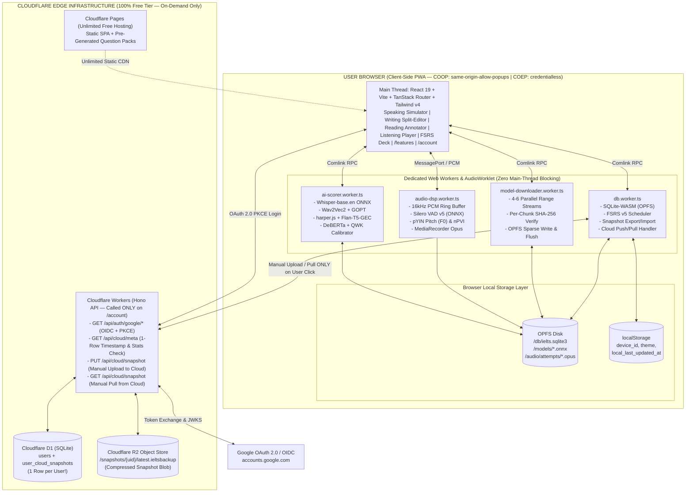

---

## 3. Why Zero On-Device Generative LLM? The Pre-Generated Question Bank Architecture

Using an on-device generative LLM (such as Qwen-1.5B or Llama-1B) to generate IELTS questions or grade open-ended answers on the fly is an **anti-pattern** because:
1. **Low Prompt Quality**: Small LLMs drift from official Cambridge IELTS phrasing, invent invalid Reading `True/False/Not Given` logic, and ask repetitive Part 3 questions.
2. **Grading Hallucinations**: Small LLMs hallucinate grammar rules and produce non-deterministic band scores across runs.
3. **Massive Resource Bloat**: Downloading $800\text{ MB+}$ of weights and allocating $1.5\text{ GB}$ of WebGPU VRAM crashes mobile browsers and low-RAM laptops.

### 3.1 The Pre-Generated Static Question Bank + Semantic Anchor Solution

Because our question bank is **pre-generated and curated offline**, every prompt already carries its exact assessment targets before it reaches the user's browser:

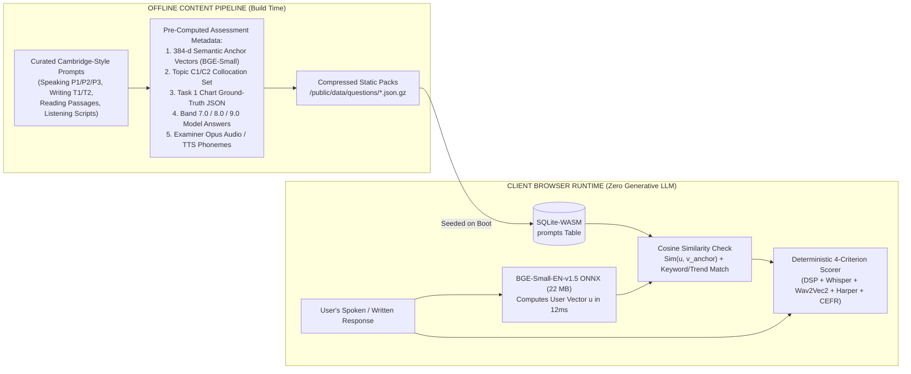

### 3.2 What Each Pre-Generated Prompt Pack Contains

```json
{
  "id": "spk_p2_tech_042",
  "module": "speaking",
  "part": 2,
  "topic": "Technology & Daily Life",
  "cue_card": {
    "prompt": "Describe a piece of technology (not a phone) that you find particularly useful.",
    "bullets": [
      "What the technology is and when you got it",
      "How often and for what purpose you use it",
      "How it compares to older ways of doing the same task",
      "And explain why you find it so useful in your daily life"
    ]
  },
  "part3_followup_tree": [
    {
      "id": "spk_p3_tech_042_q1",
      "question": "Why do some older people find it challenging to adopt new household technologies?",
      "semantic_anchors_b64": "...",
      "target_collocations": [
        "steep learning curve",
        "digital literacy",
        "user-friendly interface",
        "technological obsolescence"
      ],
      "model_answer_band85": "Primarily, I'd say it comes down to a steep learning curve combined with interfaces that aren't always designed with accessibility in mind..."
    }
  ],
  "semantic_anchors_b64": "<Base64 Float32Array of 4 x 384-dim BGE-small vectors for the 4 cue-card bullets>",
  "target_collocations": [
    "time-saving device",
    "boost productivity",
    "seamlessly integrate",
    "indispensable tool"
  ]
}
```

---

## 4. Two-Stage Specialist AI Ensemble & Complete Tech Stack

To achieve **both microscopic word-level feedback and psychometric-grade Band Score accuracy**, we use a **Two-Stage Hybrid Assessment Architecture** modeled after industrial automated speech scoring systems (ETS SpeechRater / Cambridge Speak & Improve):
1. **Stage 1 — 5 Specialist Feature & Error Extractor Models**: Dedicated acoustic, phonetic, syntactic, and discourse ONNX/WASM models that inspect every millisecond of audio and every clause of text.
2. **Stage 2 — Trained Psychometric Band Calibrator**: An ordinal regression / gradient-boosted tree model (`LightGBM / MLP Calibrator ONNX`, `< 500 KB`) trained offline on **10,000+ human-examiner-graded IELTS responses** using **Quadratic Weighted Kappa ($\text{QWK}$)** loss over a 48-dimensional objective feature vector $\mathbf{x} \in \mathbb{R}^{48}$.

### 4.1 Two-Stage Specialist Scoring Architecture (Mermaid)

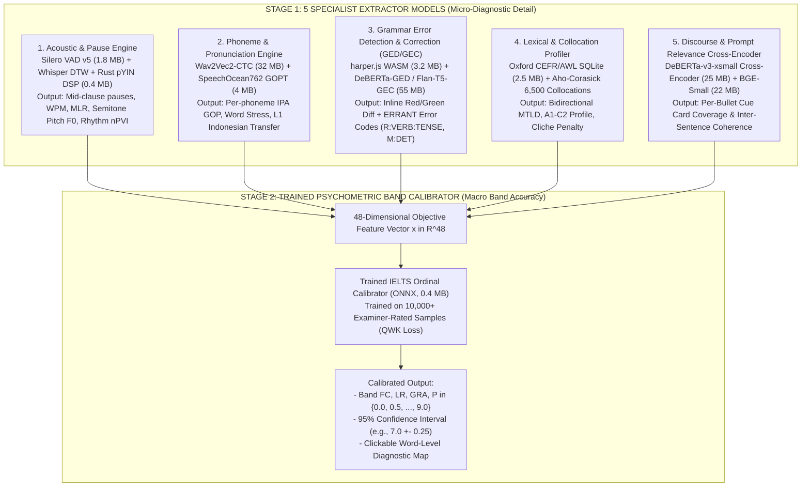

### 4.2 Complete Model & Runtime Inventory

| Tier | Component / Model | Quantized Size | Worker Target | Exact Role |
| :--- | :--- | :--- | :--- | :--- |
| **Tier 0 (Boot)** | React 19 + SQLite-WASM + FSRS v5 + Question Bank | `~2.2 MB` | Main + `db.worker.ts` | Instant UI, Reading, Listening, Flashcards (`< 1s` load) |
| **Tier 1 (Fast NLP)** | `harper.js` WASM + CEFR/AWL + Collocation Trie + Calibrator | **`~6.1 MB`** | `ai-scorer.worker.ts` | Instant Writing & Lexical/Grammar baseline (`< 1.5s` download) |
| **Tier 2 (Speech Core)** | **Silero VAD v5** (`1.8 MB`) + **Rust pYIN DSP** (`0.4 MB`) + **Whisper-base.en** (`74 MB`) | **`~76.2 MB`** | `audio-dsp` + `ai-scorer` | Full verbatim ASR, word timestamps, pause classification, pitch & rhythm |
| **Tier 3 (Deep Specialist)** | **Wav2Vec2-CTC + GOPT** (`36 MB`) + **Flan-T5-GEC / DeBERTa-GED** (`55 MB`) + **DeBERTa Cross-Encoder** (`25 MB`) | **`~116.0 MB`** | `ai-scorer.worker.ts` | Phoneme IPA forced alignment, ERRANT grammar diffs, bullet-point entailment |

---

## 5. Zero-Pain Model Delivery: Unlimited Multi-CDN, Multi-Point Parallel Download & Crash-Resilient OPFS Resume

Downloading `~76 MB` (Core Speech) or `~195 MB` (Full Specialist Suite) using a standard single-stream browser `fetch()` is fragile: if the user closes the tab at `90%` or their laptop/phone battery dies, `Cache.put()` discards the entire incomplete stream and forces a `0%` restart.

To guarantee a **zero-pain user experience**, we implement a dedicated **Multi-Point Range Downloader (`model-downloader.worker.ts`)** backed by **OPFS Sparse File Staging** and **Unlimited-Request Multi-Mirror CDNs**.

### 5.1 Unlimited-Request, Zero-Egress Multi-CDN Topology

We use a **3-Tier Content-Addressed CDN Waterfall** with automatic mirror failover and **zero request or bandwidth billing**:

| Priority | CDN Provider | Endpoint Pattern | Why Unlimited & Free? | Capabilities |
| :--- | :--- | :--- | :--- | :--- |
| **Primary Mirror** | **HuggingFace Hub LFS Global CDN** (CloudFront / Fastly) | `https://huggingface.co/{org}/{repo}/resolve/{commit_sha}/{file}` | 100% free unlimited bandwidth & unlimited requests for public ONNX models. | Native HTTP/2 & HTTP/3 multiplexing, `Accept-Ranges: bytes` (`206 Partial Content`), immutable commit SHAs. |
| **Secondary Mirror** | **Cloudflare R2 + Custom Domain Edge Cache** (`Cache Everything`) | `https://cdn.ielts-local.app/models/{sha256_chunk}.bin` | By attaching a Custom Domain to R2 with a Cloudflare Cache Rule (`Cache Everything`, Edge TTL = `1 year`, `Cache-Control: public, max-age=31536000, immutable`), **99.9%+ of requests hit Cloudflare's free CDN Edge (`CF-Cache-Status: HIT`)**, which has **unlimited free requests, zero bandwidth fees, and consumes 0 R2 Class B operations**. | Sub-$15\text{ ms}$ Indonesian/SEA edge latency (Jakarta/Singapore PoPs), HTTP/3 + Range support. |
| **Tertiary Mirror** | **GitHub Releases + jsDelivr Global CDN** | `https://cdn.jsdelivr.net/gh/rafaelatantya/ielts@{tag}/...` | Unlimited free requests for static Question Packs, CEFR dictionaries, and `< 5 MB` WASM binaries. | Multi-CDN balancing (Cloudflare + Fastly). |

---

### 5.2 Multi-Point Parallel Range Downloader & Crash-Resilient OPFS Resume Architecture (Mermaid)

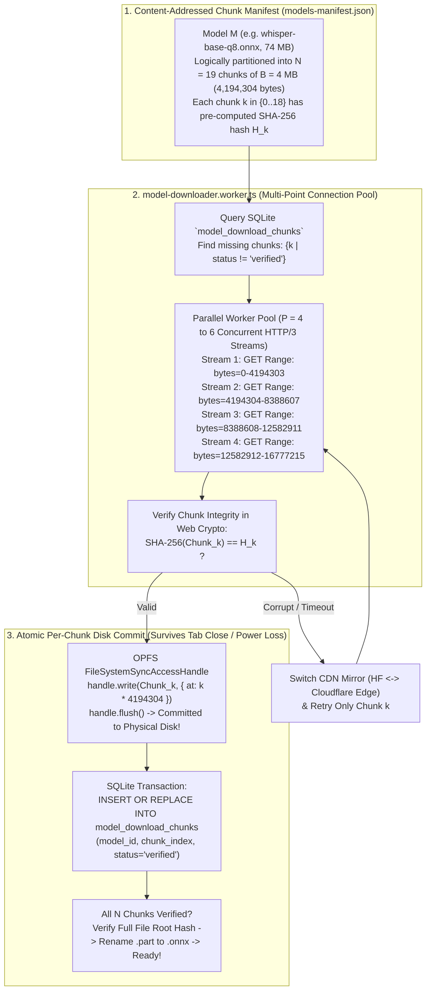

---

### 5.3 Crash-Resilient Resume Sequence: What Happens When User Closes Tab or Device Dies? (Mermaid)

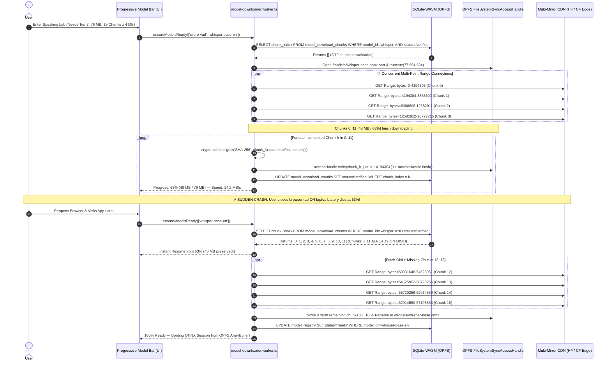

---

### 5.4 Mathematical Formulation of the Multi-Point Chunked Downloader

Let a model artifact $M$ have total byte length $L$ and be divided into $N = \lceil L / B \rceil$ fixed-size chunks of size $B = 4,194,304\text{ bytes}$ ($4\text{ MiB}$).

1. **Byte Interval for Chunk $k \in \lbrace 0, 1, \dots, N-1 \rbrace$**:

$$
\text{start}(k) = k \cdot B, \qquad \text{end}(k) = \min\big(L - 1, (k + 1) \cdot B - 1\big)
$$

2. **Per-Chunk Cryptographic Verification**:
   Before any chunk is marked as committed, its SHA-256 digest must match the manifest hash $H_k$:

$$
\text{Valid}(k) \iff \text{SHA256}\Big(\text{Buffer}\big[\text{start}(k) : \text{end}(k)\big]\Big) = H_k
$$

3. **Out-of-Order Sparse OPFS Write**:
   Because chunks arrive out of order across $P$ parallel HTTP streams (e.g., Chunk 3 finishes before Chunk 1), `FileSystemSyncAccessHandle` writes each verified buffer directly at its exact physical offset $\text{start}(k)$:

```ts
// Inside model-downloader.worker.ts
const syncHandle = await opfsFileHandle.createSyncAccessHandle();
const bytesWritten = syncHandle.write(chunkUint8Array, { at: chunkIndex * 4_194_304 });
syncHandle.flush(); // Guarantees bytes survive OS/power crash
```

4. **Dynamic Bandwidth & ETA Estimator (Exponential Moving Average)**:
   To give the user a smooth, non-jumping progress bar and accurate ETA:

$$
v_t = \beta \cdot v_{t-1} + (1 - \beta) \cdot \frac{\Delta \text{bytes}_t}{\Delta t}, \qquad \text{ETA}_t = \frac{L - \sum_{k \in \mathcal{V}} \text{size}(k)}{v_t} \quad (\beta = 0.85)
$$

where $\mathcal{V}$ is the set of already-verified chunk indices in SQLite.

---

### 5.5 Strict Zero-Auto-Download Policy: `/features` Tab & Contextual Speaking Opt-In

To protect users on metered mobile data or cellular hotspots, **no AI model is ever downloaded automatically on page load or silently in the background without explicit user consent**.

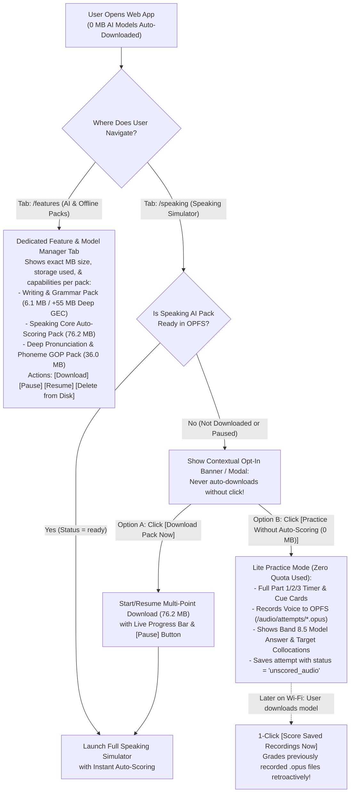

#### Key UX Rules for Quota-Safe Model Management:
1. **Dedicated `/features` (AI Feature Packs) Tab**:
   - Displays all modular AI packs with exact byte sizes, verified chunk progress (e.g., `12/19 Chunks Verified — 48.0 MB / 76.2 MB saved on disk`), and `navigator.storage.estimate()` disk usage.
   - Allows users to **Download**, **Pause**, **Resume**, or **Delete** individual model packs to free up disk space at any time without losing their SQLite study progress.
2. **Contextual Opt-In When Entering Speaking (`/speaking`)**:
   - If the user enters the Speaking Lab before downloading the Speaking AI Pack, the UI displays an explicit choice card instead of starting a download automatically.
   - Checks `navigator.connection?.saveData` and `navigator.connection?.effectiveType` to display a friendly data-saver heads-up if the user is on a cellular connection.
3. **Zero-Quota Lite Mode + Retroactive Scoring (`status = 'unscored_audio'`)**:
   - Users who choose **"Practice Without Auto-Scoring (0 MB)"** can still record their Part 1, 2, and 3 answers (`~180 KB/min` Opus saved to OPFS) and study the pre-generated Band 8.5 model answers.
   - Once they connect to Wi-Fi and download the Speaking AI Pack (either from `/features` or `/speaking`), a **"Score $N$ Saved Recordings"** button appears, running the full WASM/ONNX scoring pipeline retroactively on their saved `.opus` recordings!

---

## 6. IELTS Speaking Auto-Scoring Engine (Mathematical & DSP Formulation)

### 6.1 End-to-End Speaking Signal Flow (Mermaid)

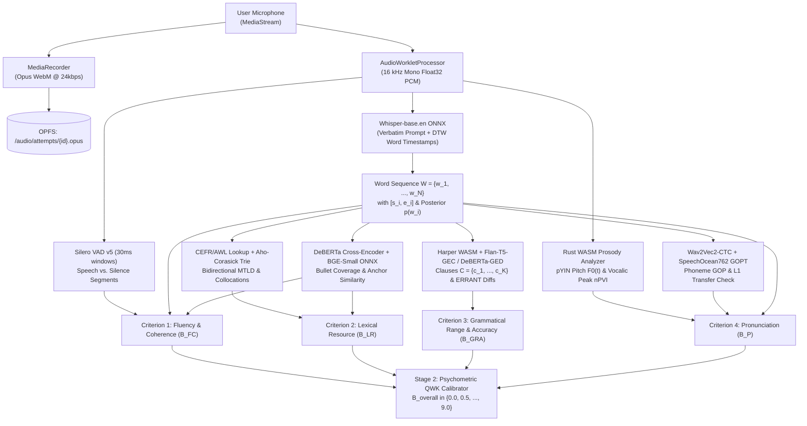

### 6.2 Preserving Verbatim Disfluencies in Whisper

Standard Whisper strips out `"um"`, `"uh"`, and false starts, which would artificially inflate a candidate's Fluency score. We condition Whisper's decoder with a **verbatim disfluency prefix prompt**:

```ts
const VERBATIM_INITIAL_PROMPT =
  "Um, uh, er, ah, hmm, like, you know, I mean, well, so, actually... " +
  "I- I think, the the thing is, let me see.";
```

With `return_timestamps: "word"`, Whisper outputs a sequence of $N$ words $W = \lbrace w_1, w_2, \dots, w_N \rbrace$, where each word $w_i$ has start time $s_i$, end time $e_i$, and acoustic token probability $p(w_i) \in (0, 1]$.

---

### 6.3 Criterion 1: Fluency and Coherence (FC)

Let $T_{\text{total}}$ be total response duration in seconds, and let $T_{\text{speech}}$ be total phonation time where Silero VAD probability $p_{\text{VAD}}(t) > 0.5$.

#### 1. Speech Rate (WPM) and Articulation Rate (AR)

$$
\text{WPM} = \frac{60 \cdot N}{T_{\text{total}}}, \qquad \text{AR} = \frac{\sum_{i=1}^{N} \text{syllables}(w_i)}{T_{\text{speech}}}
$$

#### 2. Phonation-Time Ratio (PTR)

$$
\text{PTR} = \frac{T_{\text{speech}}}{T_{\text{total}}} \in [0, 1]
$$

#### 3. Structural Clause-Boundary Pauses vs. Mid-Clause Hesitation Pauses
For every inter-word gap $\Delta t_i = s_{i+1} - e_i$:
- **Micro-pause** ($\Delta t_i < 0.25\text{ s}$): Natural articulatory stop closure (ignored).
- **Clause-Boundary Pause** ($\Delta t_i \in [0.25\text{ s}, 0.80\text{ s}]$ at punctuation `.`, `,`, `;` or conjunction boundary): Natural breathing/prosodic boundary (**zero penalty**).
- **Mid-Clause Hesitation Pause ($P_{\text{mid}}$)**: $\Delta t_i \ge 0.40\text{ s}$ occurring **inside** a syntactic phrase (e.g., between determiner and noun `"the [0.6s] government"`). Counted per $100$ words:

$$
R_{P_{\text{mid}}} = \frac{100}{N} \cdot \left\lvert \left\lbrace i : \Delta t_i \ge 0.40 \land \neg\text{isClauseBoundary}(i) \right\rbrace \right\rvert
$$

- **Long Freeze Pause Rate ($R_{P_{\text{long}}}$)**: Pauses where $\Delta t_i \ge 1.20\text{ s}$ per $100$ words:

$$
R_{P_{\text{long}}} = \frac{100}{N} \cdot \left\lvert \left\lbrace i : \Delta t_i \ge 1.20 \right\rbrace \right\rvert
$$

#### 4. Mean Length of Run (MLR)
Average number of words spoken continuously between any pauses $\Delta t_i \ge 0.30\text{ s}$:

$$
\text{MLR} = \frac{N}{1 + \left\lvert \left\lbrace i : \Delta t_i \ge 0.30 \right\rbrace \right\rvert}
$$

#### 5. Disfluency Rate (DFR)

$$
\text{DFR} = \frac{100}{N} \left( N_{\text{fillers}} + N_{\text{repeats}} + N_{\text{false-starts}} \right)
$$

#### 6. Semantic Topic Relevance Gate
Let $\mathbf{u} \in \mathbb{R}^{384}$ be the `bge-small-en-v1.5` embedding of the candidate's transcript and $\lbrace \mathbf{v}_1, \dots, \mathbf{v}_M \rbrace$ be the pre-computed semantic anchor vectors for the prompt:

$$
\tau_{\text{topic}} = \max_{m \in \lbrace 1,\dots,M \rbrace} \frac{\mathbf{u} \cdot \mathbf{v}_m}{\lVert \mathbf{u} \rVert_2 \lVert \mathbf{v}_m \rVert_2}
$$

If $\tau_{\text{topic}} < 0.45$, an off-topic penalty $\Delta_{\text{topic}} = -1.5$ is applied (preventing candidates from reciting a memorized speech unrelated to the question).

#### 7. Combined Fluency & Coherence Score

$$
\hat{B}_{\text{FC}} = \text{clamp}_{[1, 9]}\left( 9.0 - \frac{\alpha_1 \max(0, 130 - \text{WPM}) + \alpha_2 R_{P_{\text{mid}}} + \alpha_3 R_{P_{\text{long}}} + \alpha_4 \text{DFR} + \alpha_5 \max(0, 8.0 - \text{MLR})}{1 + 0.15 S_{\text{cohesion}}} + \Delta_{\text{topic}} \right)
$$

---

### 6.4 Criterion 2: Lexical Resource (LR)

#### 1. Bidirectional MTLD (Measure of Textual Lexical Diversity)
Unlike raw Type-Token Ratio ($\text{TTR} = \frac{V}{N}$), which unfairly penalizes longer Part 2 speeches, $\text{MTLD}$ counts the average number of words required for running $\text{TTR}$ to drop to threshold $\theta = 0.72$ in both forward and backward passes:

$$
\text{MTLD} = \frac{\text{MTLD}_{\text{forward}}(\theta) + \text{MTLD}_{\text{backward}}(\theta)}{2}
$$

#### 2. CEFR & Academic Word List Sophistication Index
For all lemmatized content words $N_{\text{content}}$ matched against the local `cefr_lexicon` table:

$$
S_{\text{CEFR}} = \frac{1.0 N_{\text{B1}} + 2.0 N_{\text{B2}} + 3.5 N_{\text{C1}} + 5.0 N_{\text{C2}}}{N_{\text{content}}}, \qquad R_{\text{adv}} = \frac{N_{\text{B2}} + N_{\text{C1}} + N_{\text{C2}} + N_{\text{AWL}}}{N_{\text{content}}}
$$

#### 3. Idiomatic & Collocation Density
Let $N_{\text{colloc}}$ be the number of distinct multi-word collocations and phrasal verbs matched by the Aho-Corasick automaton (including prompt-specific `target_collocations`), and $N_{\text{cliche}}$ be memorized template cliches:

$$
S_{\text{colloc}} = \min\left( 1.0, \frac{N_{\text{colloc}} + 0.2 N_{\text{cliche}}}{4.0} \right)
$$

#### 4. Prompt Paraphrasing Score
Given prompt content lemmas $L_Q$ and the candidate's opening response lemmas $L_A$:

$$
S_{\text{para}} = \tau_{\text{topic}} \cdot \left( 1 - \frac{\lvert L_Q \cap L_A \rvert}{\lvert L_Q \cup L_A \rvert} \right)
$$

High semantic similarity ($\tau_{\text{topic}}$) paired with low verbatim word copying yields a high paraphrasing score.

---

### 6.5 Criterion 3: Grammatical Range and Accuracy (GRA)

#### 1. Error-Free Clause Ratio (EFC)
The transcript is split into $K$ clauses $C = \lbrace c_1, c_2, \dots, c_K \rbrace$. Using `harper.js` (WASM) and the `Flan-T5-small-GEC / DeBERTa-GED` grammar engine (checking subject-verb agreement, tense consistency, article usage, and preposition subcategorization):

$$
\text{EFC} = \frac{\left\lvert \left\lbrace c_k \in C : \text{errorCount}(c_k) = 0 \right\rbrace \right\rvert}{K}
$$

#### 2. Weighted Error Density (WED)
Errors are classified by severity weight $\omega_e \in \lbrace 0.5, 1.0, 2.0 \rbrace$ (corresponding to $0.5$ for minor slips, $1.0$ for local grammatical errors, and $2.0$ for communication-impeding errors):

$$
\text{WED} = \frac{\sum_{e \in E} \omega_e}{K}
$$

#### 3. Syntactic Complexity & Range Index
Let $K_{\text{sub}}$ be the number of subordinate/dependent clauses and $F_{\text{used}} \in \lbrace 0, \dots, 10 \rbrace$ be the count of distinct complex grammatical families detected (relative clauses, conditionals, passive voice, perfect continuous, modals of deduction, cleft sentences, participial phrases, comparatives, subjunctive, negative inversion):

$$
\text{SCR} = \frac{K_{\text{sub}}}{K}, \qquad S_{\text{range}} = 0.6 \cdot \min\left(1.0, \frac{F_{\text{used}}}{5.0}\right) + 0.4 \cdot \min\left(1.0, \frac{\text{SCR}}{0.40}\right)
$$

#### 4. Combined GRA Score

$$
\hat{B}_{\text{GRA}} = \text{clamp}_{[1, 9]}\left( 3.0 + 4.2 \cdot \text{EFC} + 2.2 \cdot S_{\text{range}} - 1.5 \cdot \text{WED} \right)
$$

---

### 6.6 Criterion 4: Pronunciation (P)

#### 1. ASR Acoustic Confidence & Low-Confidence Word Ratio (LCWR)

$$
\bar{P}_{\text{ASR}} = \frac{1}{N} \sum_{i=1}^{N} p(w_i), \qquad \text{LCWR} = \frac{\left\lvert \left\lbrace w_i : p(w_i) < 0.65 \right\rbrace \right\rvert}{N}
$$

#### 2. Phoneme Goodness of Pronunciation (GOP) & Indonesian L1 Transfer
For each target phoneme $\phi$ spanning audio frames $t \in [t_1, t_2]$ with duration $T_\phi = t_2 - t_1 + 1$, Wav2Vec2-CTC + GOPT yields frame posterior $P(\phi \mid x_t)$:

$$
\text{GOP}(\phi) = \frac{1}{T_\phi} \sum_{t=t_1}^{t_2} \log \left( \frac{P(\phi \mid x_t)}{\max_{\psi \in \Phi} P(\psi \mid x_t)} \right) \le 0
$$

The analyzer specifically flags common Indonesian L1 phonological substitutions:
- Dental fricatives: $/ \theta / \to / \text{t} /$ (*think* $\to$ *tink*) and $/ \eth / \to / \text{d} /$ (*that* $\to$ *dat*)
- Labiodental fricative: $/ \text{v} / \to / \text{f} /$ (*very* $\to$ *fery*)
- Palato-alveolar sibilant: $/ \int / \to / \text{s} /$ (*she* $\to$ *see*)
- Final cluster reduction & missing inflectional codas (`-ed` $/ \text{t}, \text{d}, \text{Id} /$ and `-s` $/ \text{s}, \text{z}, \text{Iz} /$)

#### 3. Gender-Invariant Pitch Variation in Semitones
Using the pYIN pitch detector over voiced frames, raw frequency $F_0(t)$ (Hz) is normalized against the speaker's median frequency $F_{0,\text{med}}$:

$$
f_{\text{ST}}(t) = 12 \log_2 \left( \frac{F_0(t)}{F_{0,\text{med}}} \right), \qquad \sigma_{F_0,\text{ST}} = \sqrt{\frac{1}{T_{\text{voiced}}} \sum_{t=1}^{T_{\text{voiced}}} \left( f_{\text{ST}}(t) - \bar{f}_{\text{ST}} \right)^2}
$$

- Flat/monotone delivery: $\sigma_{F_0,\text{ST}} < 1.8\text{ ST}$ (penalized).
- Natural expressive English prosody: $2.5 \le \sigma_{F_0,\text{ST}} \le 4.8\text{ ST}$.

#### 4. Stress-Timed Rhythm via Normalized Pairwise Variability Index (nPVI)
Given $m$ consecutive vocalic syllable nucleus durations $\lbrace d_1, d_2, \dots, d_m \rbrace$:

$$
\text{nPVI} = \frac{100}{m - 1} \sum_{k=1}^{m-1} \left\lvert \frac{d_k - d_{k+1}}{(d_k + d_{k+1}) / 2} \right\rvert
$$

- Syllable-timed rhythm (flat syllable lengths): $\text{nPVI} < 42$.
- Native stress-timed English target: $52 \le \text{nPVI} \le 68$.

---

### 6.7 Official IELTS Half-Band Rounding Formula

Each criterion score $B_c$ ($c \in \lbrace \text{FC}, \text{LR}, \text{GRA}, \text{P} \rbrace$) and the overall Speaking band $B_{\text{Speaking}}$ are rounded to the nearest $0.5$ band using the official IELTS rounding rule:

$$
B_c = \frac{\lfloor 2 \hat{B}_c + 0.5 \rfloor}{2}, \qquad \bar{B} = \frac{B_{\text{FC}} + B_{\text{LR}} + B_{\text{GRA}} + B_{\text{P}}}{4}, \qquad B_{\text{Speaking}} = \frac{\lfloor 2 \bar{B} + 0.5 \rfloor}{2}
$$

---

## 7. Writing, Reading, Listening & FSRS v5 Study Modules

### 7.1 IELTS Writing Auto-Scoring Lab (Task 1 & Task 2)
- **Pre-Generated Visuals & Ground-Truth Metadata**:
  - **Academic Task 1**: Dynamic SVG bar/line/pie charts, tables, process diagrams, and maps. Each prompt in `prompts` includes a structured ground-truth spec (`key_trends`, `max_min_entities`, `comparison_pairs`, `required_units`). The scorer deterministically checks whether the candidate's essay mentions the required overview trends and numerical comparisons.
  - **Task 2 Essay**: Curated prompts across all 5 official essay types with pre-computed semantic anchor vectors for each prompt question part.
- **Weighted Overall Writing Band**:

$$
\bar{B}_{\text{Writing}} = \frac{B_{\text{Task1}} + 2 \cdot B_{\text{Task2}}}{3}, \qquad B_{\text{Writing}} = \frac{\lfloor 2 \bar{B}_{\text{Writing}} + 0.5 \rfloor}{2}
$$

### 7.2 Reading & Listening Simulators
- **Reading**: 3-passage split-screen interface with persistent highlighters (Yellow/Pink/Cyan), margin notes, all 14 official question types, and 1-click **Evidence Span Jump** on post-test review.
- **Listening**: 4-section Opus audio player (`24 kbps`, $\approx 4.5\text{ MB}$ per full 30-minute test) + deterministic **Answer Normalizer** handling UK/US spelling (`colour`/`color`), number/word equivalence (`14`/`fourteen`), date formats, and optional bracketed tokens.

### 7.3 FSRS v5 Automated Spaced Repetition (`ts-fsrs`)
After every Speaking or Writing test, the platform automatically generates flashcards from the user's actual mistakes (mispronounced words with IPA + audio comparison, grammar error cloze cards, and C1 collocation upgrades).
For a card with stability $S$ (days) and elapsed time $t$ (days), FSRS v5 models retrievability $R(t, S)$ as:

$$
R(t, S) = \left( 1 + \frac{19}{81} \cdot \frac{t}{S} \right)^{-0.5}
$$

---

## 8. Local-First Storage Architecture & ER Schema (Mermaid + SQL)

### 8.1 Local SQLite-WASM Entity-Relationship Diagram (Mermaid)

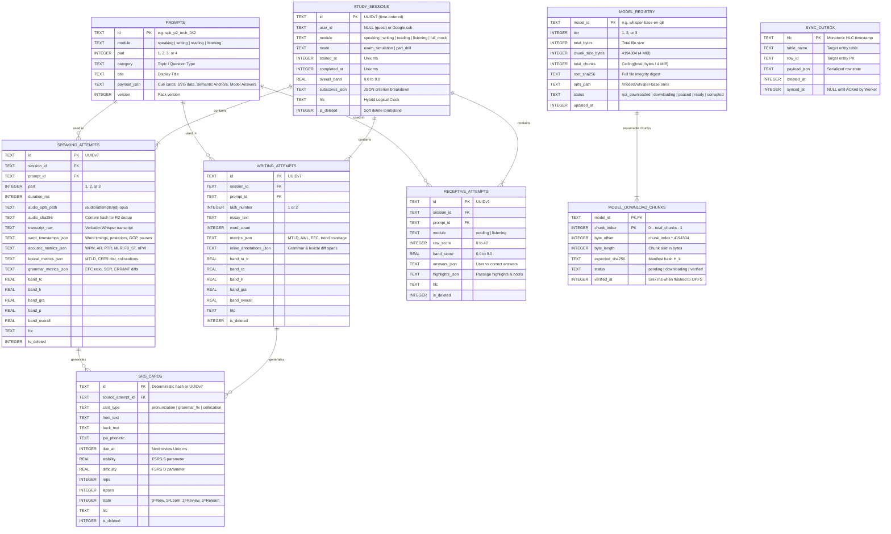

### 8.2 Complete SQLite-WASM Database Schema (`schema.sql`)

```sql
PRAGMA journal_mode = WAL;
PRAGMA synchronous = NORMAL;
PRAGMA foreign_keys = ON;

CREATE TABLE IF NOT EXISTS local_meta (
    key TEXT PRIMARY KEY,
    value TEXT NOT NULL,
    updated_at INTEGER NOT NULL
);

-- Crash-Resilient Multi-Point Model Download State Tables
CREATE TABLE IF NOT EXISTS model_registry (
    model_id TEXT PRIMARY KEY,                -- e.g., 'whisper-base-en-q8'
    tier INTEGER NOT NULL,                    -- 1, 2, or 3
    total_bytes INTEGER NOT NULL,
    chunk_size_bytes INTEGER NOT NULL DEFAULT 4194304,
    total_chunks INTEGER NOT NULL,
    root_sha256 TEXT NOT NULL,
    opfs_path TEXT NOT NULL,                  -- '/models/whisper-base-en-q8.onnx'
    primary_url TEXT NOT NULL,                -- HuggingFace LFS CDN URL
    mirror_url TEXT NOT NULL,                 -- Cloudflare R2 Custom Domain Edge URL
    status TEXT NOT NULL DEFAULT 'not_downloaded', -- 'not_downloaded' | 'downloading' | 'paused' | 'ready'
    updated_at INTEGER NOT NULL
);

CREATE TABLE IF NOT EXISTS model_download_chunks (
    model_id TEXT NOT NULL REFERENCES model_registry(model_id) ON DELETE CASCADE,
    chunk_index INTEGER NOT NULL,             -- 0 .. total_chunks - 1
    byte_offset INTEGER NOT NULL,             -- chunk_index * 4194304
    byte_length INTEGER NOT NULL,
    expected_sha256 TEXT NOT NULL,
    status TEXT NOT NULL DEFAULT 'pending',   -- 'pending' | 'downloading' | 'verified'
    verified_at INTEGER,
    PRIMARY KEY (model_id, chunk_index)
);

CREATE INDEX IF NOT EXISTS idx_model_chunks_pending
    ON model_download_chunks(model_id, status)
    WHERE status != 'verified';

CREATE TABLE IF NOT EXISTS prompts (
    id TEXT PRIMARY KEY,
    module TEXT NOT NULL,
    part INTEGER NOT NULL,
    category TEXT NOT NULL,
    title TEXT NOT NULL,
    payload_json TEXT NOT NULL,
    difficulty_band REAL DEFAULT 7.0,
    version INTEGER NOT NULL DEFAULT 1
);

CREATE TABLE IF NOT EXISTS study_sessions (
    id TEXT PRIMARY KEY,
    user_id TEXT,
    module TEXT NOT NULL,
    mode TEXT NOT NULL,
    started_at INTEGER NOT NULL,
    completed_at INTEGER,
    overall_band REAL,
    subscores_json TEXT,
    hlc TEXT NOT NULL,
    is_deleted INTEGER NOT NULL DEFAULT 0
);

CREATE INDEX IF NOT EXISTS idx_sessions_module_date ON study_sessions(module, started_at DESC);
CREATE INDEX IF NOT EXISTS idx_sessions_hlc ON study_sessions(hlc);

CREATE TABLE IF NOT EXISTS speaking_attempts (
    id TEXT PRIMARY KEY,
    session_id TEXT NOT NULL REFERENCES study_sessions(id) ON DELETE CASCADE,
    prompt_id TEXT NOT NULL,
    part INTEGER NOT NULL,
    question_text TEXT NOT NULL,
    duration_ms INTEGER NOT NULL,
    audio_opfs_path TEXT,
    audio_sha256 TEXT,
    audio_size_bytes INTEGER,
    audio_r2_synced INTEGER NOT NULL DEFAULT 0,
    transcript_raw TEXT NOT NULL,
    word_timestamps_json TEXT NOT NULL,
    acoustic_metrics_json TEXT NOT NULL,
    lexical_metrics_json TEXT NOT NULL,
    grammar_metrics_json TEXT NOT NULL,
    semantic_metrics_json TEXT NOT NULL,
    band_fc REAL NOT NULL,
    band_lr REAL NOT NULL,
    band_gra REAL NOT NULL,
    band_p REAL NOT NULL,
    band_overall REAL NOT NULL,
    created_at INTEGER NOT NULL,
    hlc TEXT NOT NULL,
    is_deleted INTEGER NOT NULL DEFAULT 0
);

CREATE INDEX IF NOT EXISTS idx_speaking_session ON speaking_attempts(session_id);
CREATE INDEX IF NOT EXISTS idx_speaking_hlc ON speaking_attempts(hlc);

CREATE TABLE IF NOT EXISTS writing_attempts (
    id TEXT PRIMARY KEY,
    session_id TEXT NOT NULL REFERENCES study_sessions(id) ON DELETE CASCADE,
    prompt_id TEXT NOT NULL,
    task_number INTEGER NOT NULL,
    essay_text TEXT NOT NULL,
    word_count INTEGER NOT NULL,
    time_spent_ms INTEGER NOT NULL,
    metrics_json TEXT NOT NULL,
    inline_annotations_json TEXT NOT NULL,
    band_ta_tr REAL NOT NULL,
    band_cc REAL NOT NULL,
    band_lr REAL NOT NULL,
    band_gra REAL NOT NULL,
    band_overall REAL NOT NULL,
    created_at INTEGER NOT NULL,
    hlc TEXT NOT NULL,
    is_deleted INTEGER NOT NULL DEFAULT 0
);

CREATE TABLE IF NOT EXISTS receptive_attempts (
    id TEXT PRIMARY KEY,
    session_id TEXT NOT NULL REFERENCES study_sessions(id) ON DELETE CASCADE,
    prompt_id TEXT NOT NULL,
    module TEXT NOT NULL,
    raw_score INTEGER NOT NULL,
    total_questions INTEGER NOT NULL DEFAULT 40,
    band_score REAL NOT NULL,
    answers_json TEXT NOT NULL,
    highlights_json TEXT,
    created_at INTEGER NOT NULL,
    hlc TEXT NOT NULL,
    is_deleted INTEGER NOT NULL DEFAULT 0
);

CREATE TABLE IF NOT EXISTS srs_cards (
    id TEXT PRIMARY KEY,
    source_attempt_id TEXT,
    card_type TEXT NOT NULL,
    front_text TEXT NOT NULL,
    back_text TEXT NOT NULL,
    context_sentence TEXT,
    ipa_phonetic TEXT,
    due_at INTEGER NOT NULL,
    stability REAL NOT NULL DEFAULT 0,
    difficulty REAL NOT NULL DEFAULT 0,
    elapsed_days INTEGER NOT NULL DEFAULT 0,
    scheduled_days INTEGER NOT NULL DEFAULT 0,
    reps INTEGER NOT NULL DEFAULT 0,
    lapses INTEGER NOT NULL DEFAULT 0,
    state INTEGER NOT NULL DEFAULT 0,
    last_review_at INTEGER,
    hlc TEXT NOT NULL,
    is_deleted INTEGER NOT NULL DEFAULT 0
);

CREATE INDEX IF NOT EXISTS idx_srs_due ON srs_cards(is_deleted, due_at ASC);

CREATE TABLE IF NOT EXISTS sync_outbox (
    hlc TEXT PRIMARY KEY,
    table_name TEXT NOT NULL,
    row_id TEXT NOT NULL,
    payload_json TEXT NOT NULL,
    created_at INTEGER NOT NULL,
    synced_at INTEGER
);

CREATE INDEX IF NOT EXISTS idx_outbox_unsynced ON sync_outbox(synced_at) WHERE synced_at IS NULL;
```

---

## 9. Deterministic Export & Import System (Backup / Restore / CRDT Merge)

### 9.1 Export & Import State Machine (Mermaid)

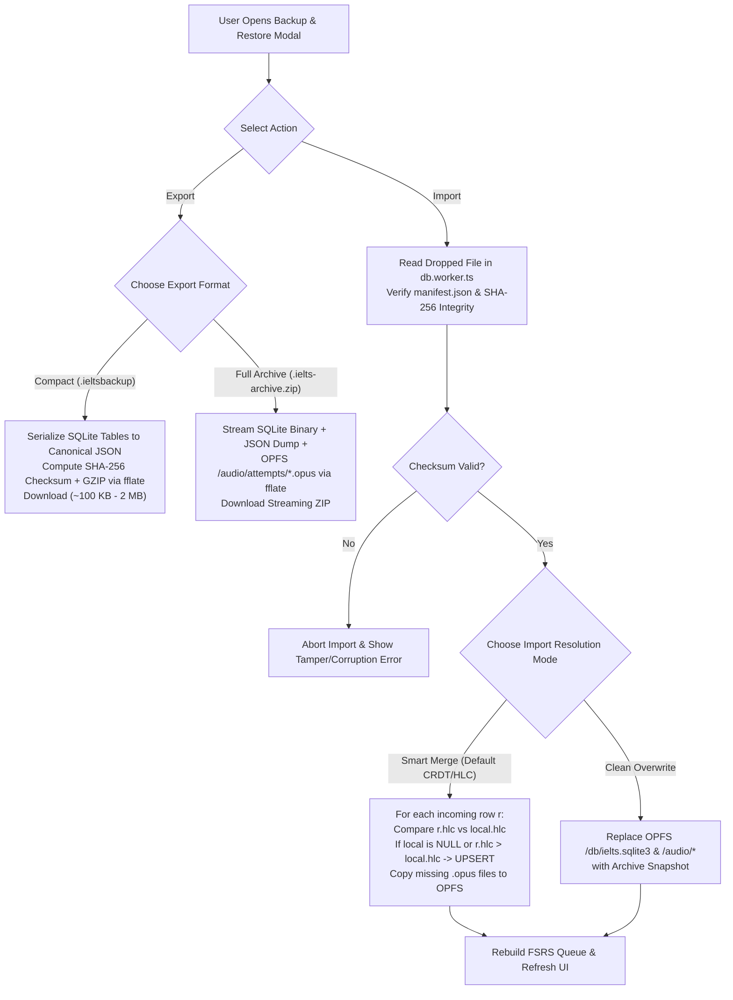

### 9.2 Mathematical Guarantee of CRDT / HLC Smart Merge
Let $S_{\text{local}}$ and $S_{\text{import}}$ be two database states (e.g., from a user's laptop and phone). Every mutable row $x$ identified by primary key $k$ carries a strictly totally ordered Hybrid Logical Clock timestamp $\text{hlc}(x)$. The merged state $S_{\text{merged}}(k)$ for key $k$ is defined as a **Last-Write-Wins Element-Set (LWW-Element-Set) join-semilattice**:

$$
S_{\text{merged}}(k) = S_{\text{local}}(k) \sqcup S_{\text{import}}(k) = \arg\max_{r \in \lbrace S_{\text{local}}(k), S_{\text{import}}(k) \rbrace} \text{hlc}(r)
$$

Specifically, for every primary key $k$:
- If $k \notin S_{\text{import}}$, keep $S_{\text{local}}(k)$.
- If $k \notin S_{\text{local}}$, insert $S_{\text{import}}(k)$.
- If $k \in S_{\text{local}} \cap S_{\text{import}}$ and $\text{hlc}\big(S_{\text{import}}(k)\big) > \text{hlc}\big(S_{\text{local}}(k)\big)$, overwrite with $S_{\text{import}}(k)$; otherwise keep $S_{\text{local}}(k)$.

Because this join operation $\sqcup$ is **commutative** ($A \sqcup B = B \sqcup A$), **associative** ($(A \sqcup B) \sqcup C = A \sqcup (B \sqcup C)$), and **idempotent** ($A \sqcup A = A$), importing the same backup file multiple times or merging across 3+ devices is mathematically guaranteed never to duplicate or lose progress.

---

## 10. Google OAuth 2.0 & Manual Cloud Snapshot Sync on `/account` Tab (Mermaid)

To guarantee **zero background server load** and stay permanently within Cloudflare's Free Tier even with tens of thousands of users, **there is no automatic background sync**.
- All study activity (Speaking, Writing, Reading, Listening, Flashcards) runs 100% locally in OPFS with **0 API calls**.
- Server interaction happens **exclusively inside the `/account` Tab** when the user explicitly logs in with Google and clicks either **"Upload Data to Cloud"** or **"Pull Data from Cloud"**.

### 10.1 Sequence Diagram: Google Login, Side-by-Side Comparison & Double-Confirmed Push/Pull

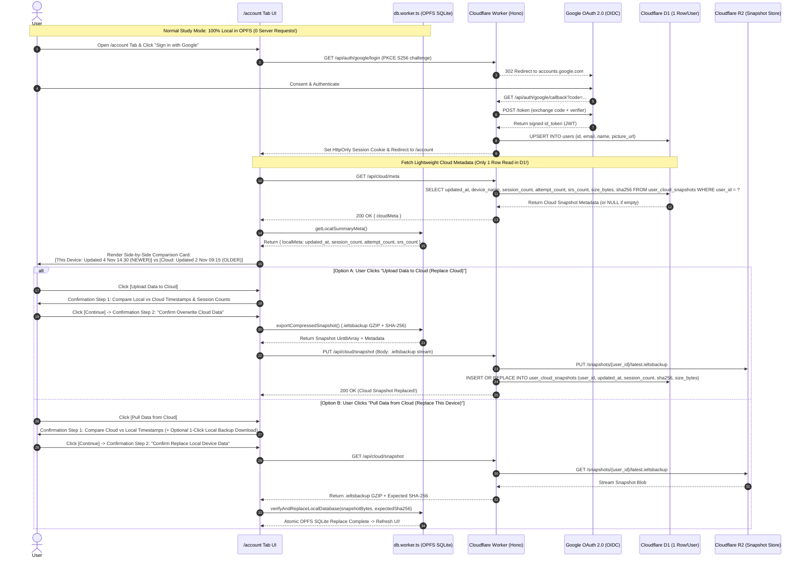

### 10.2 Double-Confirmation & Timestamp Comparison UX (`/account` Tab)

Before any **Upload to Cloud** or **Pull from Cloud** action executes, the user is shown a mandatory **2-Step Comparison & Confirmation Dialog**:

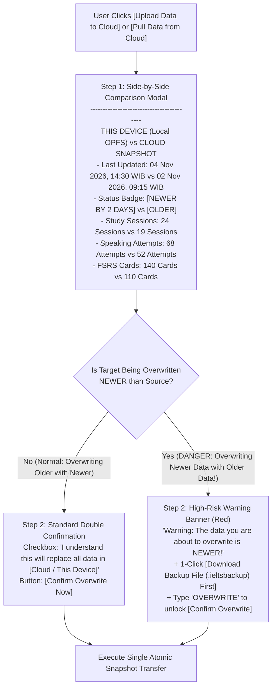

### 10.3 Minimalist Cloudflare D1 Server Schema (`workers/api/migrations/0001_init.sql`)

Because we store a single compressed snapshot per user in R2 rather than syncing thousands of individual rows on every click, the Cloudflare D1 database requires **only 2 ultra-lightweight tables** (1 row per user!):

```sql
CREATE TABLE IF NOT EXISTS users (
    id TEXT PRIMARY KEY,                      -- Google OIDC 'sub' claim
    email TEXT NOT NULL UNIQUE,
    name TEXT NOT NULL,
    picture_url TEXT,
    created_at INTEGER NOT NULL,
    last_login_at INTEGER NOT NULL
);

CREATE TABLE IF NOT EXISTS user_cloud_snapshots (
    user_id TEXT PRIMARY KEY REFERENCES users(id) ON DELETE CASCADE,
    r2_object_key TEXT NOT NULL,              -- '/snapshots/{user_id}/latest.ieltsbackup'
    local_updated_at INTEGER NOT NULL,        -- Timestamp of last local study activity inside snapshot
    uploaded_at INTEGER NOT NULL,             -- Server timestamp when snapshot was uploaded
    device_label TEXT NOT NULL,               -- e.g., 'Chrome on Windows 11'
    session_count INTEGER NOT NULL DEFAULT 0,
    speaking_count INTEGER NOT NULL DEFAULT 0,
    writing_count INTEGER NOT NULL DEFAULT 0,
    srs_card_count INTEGER NOT NULL DEFAULT 0,
    size_bytes INTEGER NOT NULL,
    sha256_checksum TEXT NOT NULL
);
```

---

## 11. Hosting & Cloudflare Free-Tier Capacity Math (Unlimited Static + Ultra-Low API Usage)

### 11.1 Why Cloudflare Pages is the Ultimate Free Hosting Choice
- **Unlimited Static Requests & Unlimited Bandwidth (USD 0/month)**:
  Unlike Vercel (100 GB/month limit) or Netlify (100 GB/month limit), **Cloudflare Pages has NO bandwidth cap and NO request cap** on the Free Plan for static assets (HTML, JS, CSS, WASM, and static Question Bank JSON packs).
- **Same-Origin Pages Functions (Workers) + D1 + R2**:
  The Hono API runs on the exact same domain (`/api/*`), eliminating CORS preflight (`OPTIONS`) overhead and allowing `HttpOnly; SameSite=Lax` cookies to work natively.

### 11.2 Free-Tier Capacity Math with Manual Snapshot Sync

Because users only hit the Worker API when they explicitly open `/account` and click **Upload** or **Pull**:

| Cloudflare Service | Free Tier Limit | Usage per Active User | Max Free Users Supported |
| :--- | :--- | :--- | :--- |
| **Cloudflare Pages** (Static Web Hosting) | **Unlimited requests & Unlimited bandwidth** | All daily study sessions, UI, WASM, & Question Packs | **Unlimited DAU** |
| **Cloudflare Workers** (`/api/*`) | $100,000\text{ requests / day}$ | $0\text{ requests}$ during daily study; $\approx 2\text{ requests}$ when manually syncing (`GET /meta` + `PUT/GET /snapshot`) | **$\approx 50,000\text{ manual syncs / day}$** |
| **Cloudflare D1 Reads** | $5,000,000\text{ rows / day}$ | **Exactly $1\text{ row read}$** per `/account` visit (`SELECT ... WHERE user_id = ?`) | **$5,000,000\text{ checks / day}$** |
| **Cloudflare D1 Writes** | $100,000\text{ rows / day}$ | **Exactly $1\text{ row write}$** per manual upload | **$100,000\text{ uploads / day}$** |
| **Cloudflare D1 Storage** | $5\text{ GB total}$ | $\approx 350\text{ bytes}$ per user (1 row in `users` + 1 row in `user_cloud_snapshots`) | **$10,000,000+\text{ users}$** |
| **Cloudflare R2 Storage** | $10\text{ GB / month}$ ($0$ egress fee) | $\approx 500\text{ KB}$ compressed `.ieltsbackup` snapshot per user (or up to $15\text{ MB}$ with recent audio) | **$20,000\text{ users}$** (at $500\text{ KB}$/snapshot) |

---

## 12. Security, Privacy & Cross-Origin Isolation

### 12.1 Cross-Origin Isolation Headers (`apps/web/public/_headers`)
To enable multi-threaded WebAssembly (`SharedArrayBuffer` for ONNX Runtime Web) while keeping Google OAuth popups/redirects and CDN model downloads working seamlessly:

```text
/*
  Cross-Origin-Opener-Policy: same-origin-allow-popups
  Cross-Origin-Embedder-Policy: credentialless
  X-Content-Type-Options: nosniff
  Referrer-Policy: strict-origin-when-cross-origin
  Permissions-Policy: microphone=(self), camera=()
```

---

## 13. Production Error Handling, Edge-Case Resilience & Bug Prevention Matrix

Local-first browser applications using WebAssembly, OPFS, WebAudio, and ONNX face specific runtime hazards that ordinary CRUD apps never encounter. Every critical edge case is handled deterministically below:

### 13.1 End-to-End Fault Tolerance & Auto-Recovery Architecture (Mermaid)

```mermaid
flowchart TB
    subgraph Edge1["1. Multi-Tab OPFS Lock Contention"]
        TAB["User Opens App in 2+ Browser Tabs"] --> LOCK["Web Locks API: navigator.locks.request('ielts_opfs_leader')"]
        LOCK -->|"Acquired Lock"| LEADER["Leader Tab Opens OPFS FileSystemSyncAccessHandle"]
        LOCK -->|"Waiting Lock"| FOLLOWER["Follower Tab Proxies SQL Queries via BroadcastChannel"]
    end

    subgraph Edge2["2. Mid-Test Mic Disconnect or Tab Crash"]
        REC["Speaking Recording Active"] --> SLICE["MediaRecorder(2000ms timeslice)<br/>Flushes .opus chunks to OPFS every 2s"]
        REC --> MIC_ERR["Mic Unplugged (onended / ondevicechange)"]
        MIC_ERR --> PAUSE["Auto-Pause Exam Timer + Show Mic Switch Modal<br/>Resume from exact 2s checkpoint!"]
    end

    subgraph Edge3["3. Whisper Silence Hallucination & Noise"]
        AUD["Recorded Audio Buffer"] --> VAD_CHK{"Silero VAD Voiced Time<br/>T_speech >= 2.0s ?"}
        VAD_CHK -->|"No (Silence / Static)"| ABORT["Reject Scoring: Return INSUFFICIENT_SPEECH_DETECTED<br/>(Prevents Whisper 'Thank you for watching' hallucination!)"]
        VAD_CHK -->|"Yes"| STRIP["Strip Non-Speech Noise Margins Before Whisper ASR"]
    end

    subgraph Edge4["4. Blue-Green Atomic DB Swap (Import / Cloud Pull)"]
        IMP["Incoming Snapshot (.ieltsbackup)"] --> STAGE["Write to /db/ielts.incoming.sqlite3<br/>Run SHA-256 + PRAGMA integrity_check"]
        STAGE -->|"Valid"| SWAP["Rename Current DB -> /db/ielts.rollback.sqlite3<br/>Promote incoming -> /db/ielts.sqlite3"]
        STAGE -->|"Corrupt / Network Drop"| ROLL["Delete incoming file — Existing DB 100% Untouched!"]
    end
```

### 13.2 Complete Edge-Case & Bug Prevention Matrix

| # | Failure Mode / Edge Case | Root Cause in Browser / WASM | Deterministic Mitigation & Recovery Protocol |
| :--- | :--- | :--- | :--- |
| **1** | **Multi-Tab OPFS Crash (`NoModificationAllowedError`)** | `FileSystemSyncAccessHandle` places an exclusive OS file lock on `/db/ielts.sqlite3`. Opening a second tab crashes the second worker. | **Web Locks + `BroadcastChannel` Leader Election**: Only 1 Leader Tab holds the OPFS handle. Follower tabs transparently route SQLite RPC over `BroadcastChannel`. If the Leader Tab closes, the next tab promotes itself in $< 20\text{ ms}$. |
| **2** | **Mic Unplugged or Browser Crash During 2-Min Speaking Part 2** | Bluetooth headset dies or accidental tab refresh at `01:45` wipes in-memory `MediaRecorder` blobs. | **2-Second OPFS Timeslice Flushing**: `mediaRecorder.start(2000)` appends and `flush()`es `.opus` chunks to `/audio/staging/active.opus` every $2\text{ s}$. On mic disconnect, the timer auto-pauses and allows hot-swapping mics; on tab crash, next boot offers **[Recover Interrupted Attempt]**. |
| **3** | **Whisper Silence Hallucinations (`"Thank you for watching"`)** | Feeding pure silence or cafe background noise into Whisper causes decoder hallucinations that would get graded as an answer. | **Silero VAD Gate + SNR Pre-Check**: If voiced duration $T_{\text{speech}} < 2.0\text{ s}$ or recognized words $N < 5$, scoring is aborted with `INSUFFICIENT_SPEECH_DETECTED` and prompts a free re-take without saving a fake score. |
| **4** | **Out-of-Memory (`OOM`) / WebGPU Context Loss on 4GB RAM Devices** | Loading all 5 ONNX models simultaneously into RAM can exceed mobile browser per-tab memory limits ($\approx 1.2\text{ GB}$). | **Sequential Model Eviction Mode**: On devices where `navigator.deviceMemory <= 4` (or on `gpu.device.lost`), `ai-scorer.worker.ts` loads 1 model at a time, runs inference, and calls `session.release()` before loading the next model — keeping peak RAM $< 280\text{ MB}$. |
| **5** | **Corrupted Cloud Pull or Backup Import Midway** | Network drops or power dies while overwriting `/db/ielts.sqlite3` during **"Pull from Cloud"** or file import. | **Blue-Green Atomic File Swap + 7-Day Rollback**: Incoming data is written to `ielts.incoming.sqlite3` and verified with `PRAGMA integrity_check;`. The old DB is moved to `ielts.rollback.sqlite3` (enabling 1-click **"Undo Last Pull/Import"**) before promoting the new DB. |
| **6** | **Two-Phase Cloud Upload (`PUT /api/cloud/snapshot`)** | User's connection drops at 80% while uploading snapshot to Cloudflare R2, risking a half-written cloud backup. | **Staging Key Promotion on Worker**: Worker streams upload to `/snapshots/{uid}/staging_{sha256}.tmp`, verifies exact byte length and SHA-256 hash on the edge, and **only then** copies to `latest.ieltsbackup` and updates D1. |
| **7** | **Background Tab Timer Drift (Writing 40m / Reading 60m)** | Browsers throttle `setInterval(fn, 1000)` when the user switches tabs or minimizes the window. | **Monotonic Wall-Clock Deadline**: Timer state stores `deadline_ms = Date.now() + duration_ms` in SQLite and computes `remaining = deadline_ms - Date.now()` on every frame + `visibilitychange`. Writing drafts auto-save to OPFS every $1,500\text{ ms}$. |
| **8** | **Storage Quota Full (`QuotaExceededError`) & Incognito Mode** | Browser runs out of disk quota mid-download, or user opens app in Private/Incognito window (which wipes OPFS on close). | **Pre-Download Quota Check & Incognito Banner**: Calls `navigator.storage.estimate()` before downloading models (requires $1.25\times$ free space). Detects ephemeral/incognito storage and shows a persistent reminder to export `.ieltsbackup` before closing. |
| **9** | **iOS Safari AudioContext Suspended / Sample Rate Mismatch** | iOS Safari forces hardware sample rate ($44.1\text{ kHz}$ or $48\text{ kHz}$) and suspends `AudioContext` unless resumed inside a direct tap handler. | **Sinc Resampler in Worklet + Tap-to-Unlock**: `AudioWorklet` resamples any native hardware rate ($44.1/48\text{ kHz}$) to exact $16,000\text{ Hz}$ mono PCM, and `audioCtx.resume()` is bound directly to the user's button pointer-down event. |

---

## 14. UI Information Architecture, Screen Blueprint & Phased Implementation Roadmap

### 14.1 Complete UI Navigation & Screen Blueprint (Mermaid)

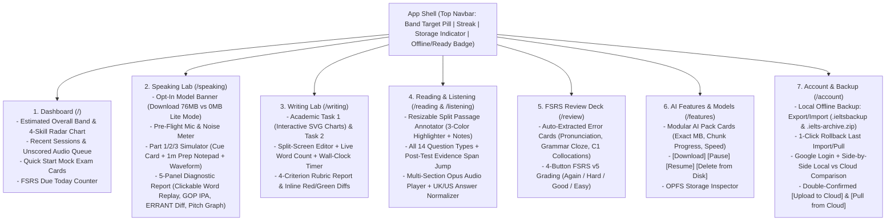

### 14.2 Repository Layout (Mermaid)

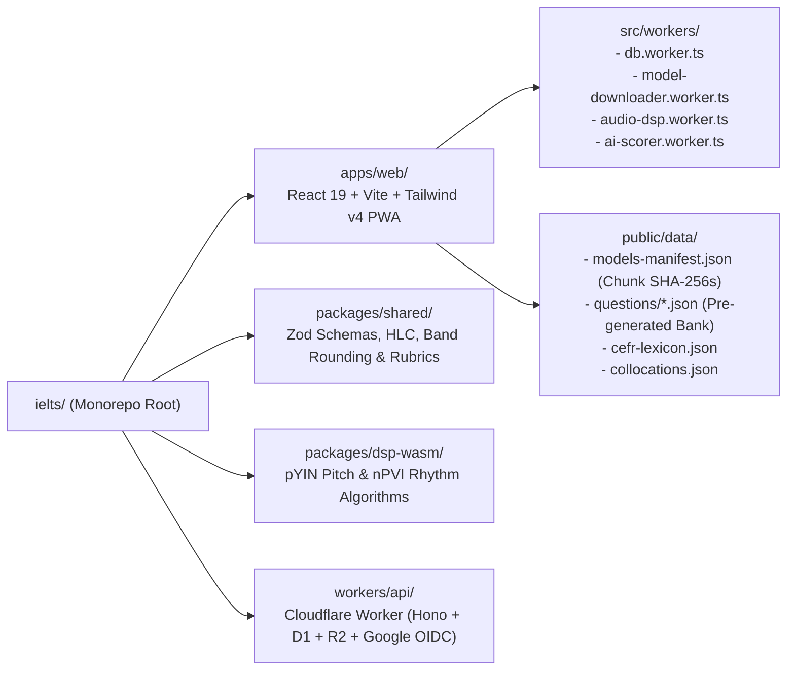

### 14.3 Phased Implementation Roadmap

1. **Phase 1: App Shell, Full UI Screen Suite & Local-First Database/Backup Core**
   - Initialize workspace (`apps/web`, `packages/shared`, `workers/api`) and build the complete 7-Tab UI Shell (`Dashboard`, `Speaking Lab`, `Writing Lab`, `Reading Simulator`, `Listening Simulator`, `FSRS Review Deck`, `/features` Model Manager, and `/account` Backup & Cloud Sync).
   - Implement Multi-Tab Leader Election, SQLite-WASM OPFS schema (`schema.sql`), Blue-Green Atomic DB Swap, and `.ieltsbackup` / `.ielts-archive.zip` Export & Import.
   - Implement `model-downloader.worker.ts` with 4-stream HTTP Range requests, per-chunk SHA-256 verification, OPFS sparse writes + `flush()`, and strict opt-in pause/resume controls.
2. **Phase 2: Pre-Generated Question Bank & Two-Stage Specialist Scoring Engine**
   - Seed curated Speaking (Part 1/2/3), Writing (Task 1 SVG charts + Task 2), Reading, and Listening question packs with pre-computed semantic anchors and target collocations.
   - Implement the 5 Specialist Extractors + Stage 2 Trained Psychometric Band Calibrator ($\text{FC}, \text{LR}, \text{GRA}, \text{P}$) + official half-band rounding + unit tests.
3. **Phase 3: Real-Time Audio Worklet, VAD, Prosody DSP & ONNX Worker Integration**
   - Wire `AudioWorkletProcessor` ($16\text{ kHz}$ PCM) + 2-second timeslice `MediaRecorder` (Opus to OPFS) + Silero VAD v5 + Pitch/nPVI DSP + Whisper ONNX + Wav2Vec2-GOPT + Flan-T5-GEC/DeBERTa + Retroactive Scoring for saved `.opus` attempts.
4. **Phase 4: Cloudflare Edge Worker, Google OAuth 2.0 & Double-Confirmed Cloud Snapshot Push/Pull**
   - Implement Hono Worker endpoints (`/api/auth/google/*`, `/api/cloud/meta`, `PUT /api/cloud/snapshot`, `GET /api/cloud/snapshot`), D1 migrations (`0001_init.sql`), and two-phase R2 atomic upload.
