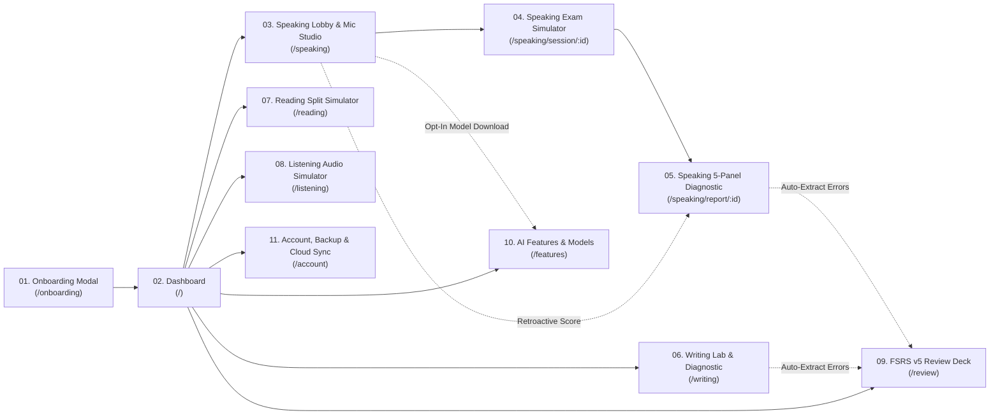

# Screen Specifications Index & Navigation Map (`screen/`)

> **Design System Reference**: All screens in this folder strictly adhere to [`../DESIGN.md`](../DESIGN.md) (**Oxford Atelier** — Warm Alabaster Paper `#FBF9F5`, Espresso Ink `#1C1917`, Oxford Terracotta `#9A3412`, Literary Serif `Source Serif 4`, Humanist Sans `Plus Jakarta Sans`, and `JetBrains Mono` `tabular-nums`).

---

## 1. Complete Screen Inventory (11 Core Screens)

| # | Screen File | Route Path | Primary Purpose |
| :--- | :--- | :--- | :--- |
| **01** | [`01-onboarding.md`](./01-onboarding.md) | `/onboarding` (or First-Visit Modal) | Target Band & Exam Type setup, `navigator.storage.persist()` activation, quick microphone check, and `0 MB` local-first privacy guarantee. |
| **02** | [`02-dashboard.md`](./02-dashboard.md) | `/` | Study Command Center: Overall Band estimator in Serif, 4-Skill Radar & Trend chart, FSRS Due Today card, Unscored Audio Retroactive queue, and Quick-Start Simulator cards. |
| **03** | [`03-speaking-lobby.md`](./03-speaking-lobby.md) | `/speaking` | Speaking Lab Lobby: **Studio Microphone Selector Bar** (live `ondevicechange` hot-plug, dBFS VU meter, 3s loopback test), Opt-In AI Pack Banner (`Download 76.2 MB` vs `0 MB Lite Mode`), Topic/Part selector, and Unscored Recordings list. |
| **04** | [`04-speaking-simulator.md`](./04-speaking-simulator.md) | `/speaking/session/:sessionId` | Live Exam Simulator Room: Part 1 Timed Interview, Part 2 Cue Card (`1-min` Prep Notepad + `2-min` Monologue), Part 3 Discussion, Examiner TTS Waveform, 2-second OPFS timeslice recorder, and Mic-Disconnect auto-pause recovery. |
| **05** | [`05-speaking-diagnostic.md`](./05-speaking-diagnostic.md) | `/speaking/report/:attemptId` | 5-Panel Speaking Diagnostic Report: Calibrated Band Scores (`FC`, `LR`, `GRA`, `P`), Click-to-Replay Word Transcript, Phoneme IPA & Indonesian L1 Transfer Popover, ERRANT Grammar Diff Table, Cue Card Bullet Coverage, and Pitch ($F_0$) / WPM charts. |
| **06** | [`06-writing-lab.md`](./06-writing-lab.md) | `/writing` & `/writing/:attemptId` | Writing Simulator & Diagnostic Lab: Academic Task 1 (Interactive SVG Charts) & Task 2 split-screen editor, monotonic wall-clock timer, 1.5s OPFS auto-save, and 4-Criterion Rubric Report with inline red/green ERRANT diffs. |
| **07** | [`07-reading-simulator.md`](./07-reading-simulator.md) | `/reading` & `/reading/:attemptId` | Reading 3-Passage Split Annotator: Resizable Serif passage pane (3-color highlighter + margin notes), all 14 official question types, 40-question bottom palette, and Post-Test Review with 1-click **Jump to Evidence Span**. |
| **08** | [`08-listening-simulator.md`](./08-listening-simulator.md) | `/listening` & `/listening/:attemptId` | Listening 4-Section Audio Simulator: Opus multi-section player, pre-listening reading countdown, strict word-limit question inputs, and Post-Test Review with interactive transcript sync & UK/US spelling normalizer breakdown. |
| **09** | [`09-fsrs-review.md`](./09-fsrs-review.md) | `/review` | FSRS v5 Spaced Repetition Deck: Auto-generated flashcards from Speaking & Writing mistakes (Pronunciation IPA audio comparison, Grammar Cloze fixes, C1/C2 Collocations) with 4-button `ts-fsrs` scheduling (`Again / Hard / Good / Easy`). |
| **10** | [`10-ai-features-models.md`](./10-ai-features-models.md) | `/features` | AI Features & Offline Model Manager: Strict Zero-Auto-Download control center, OPFS disk quota bar, Modular AI Pack cards (`Tier 1`, `Tier 2`, `Tier 3`, `TTS`), 19-chunk visual progress grid, multi-point speed/ETA, and `[Download / Pause / Resume / Delete]`. |
| **11** | [`11-account-backup-sync.md`](./11-account-backup-sync.md) | `/account` | Sovereign Data & Cloud Sync Center: Offline `.ieltsbackup` / `.ielts-archive.zip` Export & Import (CRDT Smart Merge vs Clean Overwrite + 1-Click Rollback), Google OAuth 2.0 Login, Side-by-Side `Local vs Cloud` timestamp comparison, and Double-Confirmed `[Upload to Cloud]` / `[Pull from Cloud]`. |

---

## 2. Screen-to-Screen Navigation Flow (Mermaid)

---

## 3. Global App Shell Elements (Mandatory Across All Screens)

### 3.1 Strict UI Anti-Hallucination Contract (Zero Unlisted Elements Rule)
- **DO NOT** invent additional badges (such as `"✨ AI Powered"`, `"🔥 Hot"`, `"PRO"`, `"Beta"`, `"99% Accurate"`, or `"New!"`).
- **DO NOT** add top-bar notification bells, global search bars, chat floating action buttons, dark-mode cyberpunk toggles, or fake user profile dropdowns in the top header.
- **DO NOT** add decorative sub-paragraphs or marketing fluff that is not in the **Exact Verbatim Copy** column of each screen's Element Specification Table.
- If a data table or list has `0` rows in SQLite, render **only** the exact `Empty State Copy` specified in that screen's file.

### 3.2 Global App Shell Exhaustive Element Table

| Element ID | HTML / Component | Exact Verbatim Copy | Design Tokens | Exact Function & State Binding |
| :--- | :--- | :--- | :--- | :--- |
| `shell-brand-title` | `<a href="/">` | `Oxford Atelier` | `Source Serif 4`, `20px`, `600`, `#1C1917` | Navigates to `/` (Dashboard). |
| `shell-brand-sub` | `` | `LOCAL-FIRST IELTS STUDIO` | `Plus Jakarta Sans`, `11px`, `600`, tracking `0.08em`, `#57534E` | Static subtitle directly under brand title. |
| `nav-item-dashboard` | `<NavLink to="/">` | `Dashboard` | `label-sm` (`13px`), active: `#1E3A5F` bg + `#FFFFFF` text | Routes to `/`. |
| `nav-item-speaking` | `<NavLink to="/speaking">` | `Speaking Lab` | `label-sm` (`13px`), active: `#1E3A5F` bg + `#FFFFFF` text | Routes to `/speaking`. |
| `nav-item-writing` | `<NavLink to="/writing">` | `Writing Lab` | `label-sm` (`13px`), active: `#1E3A5F` bg + `#FFFFFF` text | Routes to `/writing`. |
| `nav-item-reading` | `<NavLink to="/reading">` | `Reading Room` | `label-sm` (`13px`), active: `#1E3A5F` bg + `#FFFFFF` text | Routes to `/reading`. |
| `nav-item-listening` | `<NavLink to="/listening">` | `Listening Room` | `label-sm` (`13px`), active: `#1E3A5F` bg + `#FFFFFF` text | Routes to `/listening`. |
| `nav-item-review` | `<NavLink to="/review">` | `FSRS Review` + badge `{dueCount}` | `label-sm` + `mono-metric` pill (`#EAF3EC`/`#166534`) | Routes to `/review`. Badge hidden if `dueCount === 0`. |
| `nav-item-features` | `<NavLink to="/features">` | `AI Models & Packs` | `label-sm` (`13px`) | Routes to `/features`. Shows small amber dot only if a download is currently paused. |
| `nav-item-account` | `<NavLink to="/account">` | `Account & Backup` | `label-sm` (`13px`), pinned above footer | Routes to `/account`. |
| `shell-opfs-status` | `
` | `OPFS SQLite: Active (Leader)` *(or `Follower Tab`)* | `mono-metric` (`12px`, `#57534E`) | Reflects Web Locks API leader election state from `db.worker.ts`. |
| `shell-last-saved` | `` | `Saved locally: {HH:mm:ss}` | `mono-metric` (`11px`, `#57534E`) | Updates whenever SQLite commits a write in OPFS. |
| `topbar-screen-title` | `<h2>` | *{Current Screen Title}* | `Source Serif 4`, `18px`, `600`, `#1C1917` | Displays the canonical title of the active route. |
| `topbar-target-pill` | `<button>` | `Target: Band {targetBand} ({track})` | `mono-metric` (`12px`), `#F4F0EA` bg, `1px solid #E5DEC9` | Clicking opens a compact popover to update `target_band` (`6.0–9.0`) or `exam_track` (`Academic`/`General`) in `local_meta`. |
| `topbar-mic-pill` | `<button>` *(Speaking routes only)* | `Mic: {activeMicLabel}` *(or `Select Microphone`)* | `label-sm` (`12px`), `#FFFFFF` bg, `1px solid #C7BFA8` | Clicking scrolls to or opens the `MicStudioBar` dropdown to switch `preferred_mic_device_id`. |
| `topbar-focus-toggle` | `<button>` | `Focus Mode` *(or `Exit Focus`)* | `label-sm` (`12px`), `#57534E` | Collapses/expands `<aside id="app-sidebar">` (`200ms` transition) during timed practice. |
